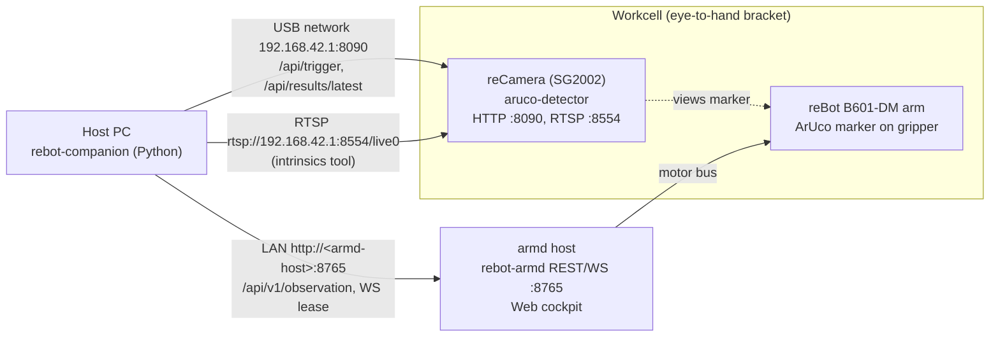

# rebot-companion · Robot Arm Vision Companion Toolkit

[中文文档](./README.zh-CN.md)

> **reCamera provides high-performance atomic sensing; remote Agents provide flexible orchestration; hardened pipelines provide deterministic execution.**

An open-source embodied robotics companion toolkit bridging **Seeed reCamera (SG2002 RISC-V edge vision)** and **rebot-armd (ultra-lightweight Rust arm daemon)**.

---

## 💡 Architecture & Boundary Definition

Given the edge compute constraints (SG2002 single-core 1.0 GHz RISC-V with 256MB RAM) and real-world industrial requirements, this toolkit enforces a clear **three-tier boundary**:

```text
┌────────────────────────────────────────────────────────┐
│  Stage 1: Remote Cloud / Host Agent Flexible Planning  │
│  Stage 2: Hardened Local Deterministic Pipeline Loop   │
└───────────────────────────┬────────────────────────────┘
                            │ REST / WebSocket
                            ▼
┌───────────────────────────────────┬────────────────────┐
│ Arm Control Daemon: rebot-armd    │ Vision Sensor: reCamera
│ - Pure Rust motor servo (50~100Hz)│ - Native C++ (Zero Python on camera)
│ - Slew Rate limiter & G(q) gravity│ - H.264 video stream (Port 8001)
│ - Watchdog & E-Stop state machine │ - On-demand single trigger /api/trigger
│ - LeRobot Parquet recorder        │ - Dynamic standby throttling (idle_fps=1)
└───────────────────────────────────┴────────────────────┘
```

### 1. reCamera Responsibility: Pure Atomic Capabilities
- **Zero Python on Camera**: To avoid CPU bottlenecks, context-switching overhead, and thermal throttling.
- **Pure Standard Endpoints**:
  - `POST /api/trigger`: Single-shot trigger estimating 6-DoF pose (`x, y, z, roll, pitch, yaw`), immediately returning to standby.
  - Frames for multimodal VLM / LLM reasoning: RTSP `rtsp://<host>:8554/live0` (1280x720). The device has no HTTP snapshot endpoint (`:80/snapshot.jpg` redirects to the supervisor UI); `ReCameraClient.get_snapshot()` works only when `snapshot_url=` is passed explicitly.
  - `WS :8001/`: Low-latency H.264 preview stream.

### 2. Two-Stage Evolution Workflow
- **Stage 1 (Exploration & Dynamic Orchestration)**:
  - Complex reasoning, multi-view inspection, and flexible task decomposition are driven by remote Agents / host Python scripts calling atomic APIs.
- **Stage 2 (Hardened Local Execution)**:
  - Once calibration matrices, trajectory points, and pick policies converge, the logic is serialized into a **deterministic local pipeline** running autonomously on the factory floor without external LLM dependencies.

---

## 📦 Project Layout

```text
rebot-companion/
├── pyproject.toml              # uv project; extras: [calib] = OpenCV for the intrinsics tool
├── rebot_companion/            # SDK
│   ├── camera_client.py        # reCamera atomic API client (trigger / latest result)
│   ├── arm_client.py           # rebot-armd client (REST reads + WebSocket lease session)
│   ├── kinematics.py           # B601-DM forward / inverse kinematics (port of the Web cockpit)
│   ├── transforms.py           # SE(3) transforms, Euler ZYX convention
│   ├── calibration.py          # hand-eye calibration: point registration + AX=XB
│   └── pipeline.py             # Stage 2 deterministic pipeline
├── examples/
│   ├── 01_atomic_api_demo.py   # reCamera + armd atomic APIs
│   ├── 02_hand_eye_calib.py    # interactive hand-eye calibration wizard
│   ├── 03_agent_orchestrator.py# Stage 1 agent tool calling
│   └── 04_hardened_pick_place.py# Stage 2 hardened pick & place
├── tools/
│   ├── calibrate_intrinsics.py # camera intrinsics + distortion (OpenCV)
│   └── gen_web_fixtures.mjs    # regenerates JS reference values for the tests
└── tests/
```

---

## 🚀 Quickstart

### 1. Install (uv)
```bash
cd rebot-companion
uv sync
uv run pytest
```

Optional OpenCV extra for the intrinsics tool: `uv sync --extra calib` (`uv sync --all-extras` for development).

### 2. Check the reCamera atomic API
```bash
uv run python examples/01_atomic_api_demo.py --url http://192.168.42.1:8090
```

### 3. Run hand-eye calibration
```bash
uv run python examples/02_hand_eye_calib.py --arm-url http://<armd-host>:8765
```
See "Hand-eye calibration" below.

### 4. Run the Stage 2 hardened pick & place
```bash
uv run python examples/04_hardened_pick_place.py
```

---

## 🔌 Topology

Eye-to-hand: the reCamera is fixed on a bracket next to the arm and looks at the workspace; the ArUco marker is on the gripper.



```text
 Host PC (rebot-companion)
   ├── USB network ──> reCamera 192.168.42.1   :8090 HTTP API, :8554 RTSP
   └── LAN ──────────> armd host <ip>          :8765 REST + WebSocket ──> arm motors
 reCamera on a fixed bracket, looking at the workspace; ArUco marker on the gripper.
```

Defaults in the examples: camera `http://192.168.42.1:8090`, arm `http://127.0.0.1:8765` (pass `--arm-url` when armd runs on another host).

---

## 🦾 Arm control

rebot-armd accepts actuator commands only on the WebSocket connection that holds the control lease; REST `motion/*`, torque and `clear_fault` return `LEASE_REQUIRED`.

- Read state without a lease: `ArmdClient.get_observation()` / `ArmdClient.get_schema()`.
- Move inside `with arm.session() as s:` (acquires the lease, heartbeats every 150 ms; armd lease timeout 2500 ms):
  `s.torque(True)`, `s.home()`, `s.move_to(q, duration=2.0)` (blocks until arrival), `s.servo_stream(frames, rate_hz=50)`, `s.unload()`.
- `ArmdClient.e_stop()` works without a lease.
- If the arm is still torqued when the session ends, armd latches `Fault(WatchdogTimeout)` about 2.5 s later, with the arm holding position. Finish with `s.unload()`, or later call `s.clear_fault()` then `s.torque(True)`.
- After a `force=True` preemption, motion is refused with `HANDOVER_SETTLING` for up to 1.5 s.

```python
from rebot_companion import ArmdClient

arm = ArmdClient("http://127.0.0.1:8765")
q = arm.get_observation().positions
with arm.session() as s:
    s.torque(True)
    s.home()
    target = [0.0] * len(q)
    target[0] = 0.2  # J1 +0.2 rad from home
    s.move_to(target, duration=2.0)
    s.unload()  # park + torque off before the lease is released
```

---

## 🎯 Hand-eye calibration

### Forward kinematics (B601-DM)

`rebot_companion.kinematics` is a line-by-line port of the rebot-armd Web cockpit FK/IK (`src/api/index.html`, `IK.fk` / `IK.solve`, URDF `urdf_b601dm`). Tests compare it against values computed by running the JS code with node (`tools/gen_web_fixtures.mjs`).

- Joints used: J1 yaw, J2/J3/J4 pitch chain; J5 is assumed to be 0; gripper ignored. Base frame: x forward, y left, z up, metres / radians.
- Raw motor positions map to model angles with `model = (motor - offset) / sign` (Web `toModel`, defaults sign `1,1,1,1`, offset `0`; same as the Web `?iksign=` / `?ikoff=` overrides; the wizard takes `--iksign` / `--ikoff`).
- `tcp_pose(q)` returns the full SE(3) TCP pose `R = Rz(q1) Ry(-q2 + q3 + q4)`, x axis = tool axis. Checked numerically against the URDF chain with the wrist joints at 0: < 0.03 mm, < 1e-4 rotation.
- `solve_ik(target, prev)` is the analytic position + pitch IK from the Web.

### Methods and assumptions

| `method` | Setup | Assumption | Uses | Result |
|---|---|---|---|---|
| `point` (default) | eye_to_hand | marker centre coincides with the TCP | positions only | `T_cam_to_base` (Horn closed form, same as the Web `solveRigid`) |
| `axxb` | eye_to_hand | marker rigid on the gripper, offset unknown | full poses | `T_cam_to_base` + `T_marker_to_gripper` |
| `axxb` | eye_in_hand | camera on the gripper, marker fixed in the scene | full poses | `T_cam_to_gripper` + `T_marker_to_base` |

- `axxb` = Park & Martin: rotation by least squares on rotation logarithms, translation by stacked linear least squares, over all sample pairs. Its result matches `cv2.calibrateHandEye(..., CALIB_HAND_EYE_PARK)` in the tests.
- `axxb` needs relative rotations about at least two non-parallel axes. With this arm, change both J1 yaw and wrist pitch (>= 15 deg) between samples. Rotation about one axis only, or < 5 deg, raises `CalibrationError`.
- Residuals: `point` reports the 3D point error per sample; `axxb` reports per-sample marker position (m) and rotation (deg) prediction errors in the camera frame. RMSE and max error are printed and saved.
- Marker orientation from the device has 0.01 deg resolution (`r_deg`, 2 decimals). `point` does not use it.
- Accuracy depends on the camera intrinsics and `MARKER_SIZE` on the device. Calibrate intrinsics first (next section).

### Wizard

```bash
# eye-to-hand, marker centre on the TCP (default)
uv run python examples/02_hand_eye_calib.py --arm-url http://<armd-host>:8765 --marker-id 0
# marker anywhere on the gripper
uv run python examples/02_hand_eye_calib.py --method axxb --arm-url http://<armd-host>:8765
# re-solve samples exported from the Web cockpit
uv run python examples/02_hand_eye_calib.py --from-web-export rebot_hand_eye_2026-11-01T10-00-00.json
```

Pose the arm by hand (torque off) or with teleop, hold it still and press Enter. Each capture checks that the arm is not moving (|v| <= 0.02 rad/s, re-checked after detection), triggers one detection, picks the marker id, computes the TCP pose with FK, rejects samples closer than 10 mm to an existing one and appends to `calib_samples.json` (`--resume` continues a session). `s` solves and prints the residual table, `d` solves and writes `calibration.json`.

### Calibration file format

`save_to_file()` writes a superset of the Web cockpit export, so files from either side load with `HandEyeCalibration.load_from_file()` (returns the transform) and `HandEyeCalibration.load_samples()` (returns samples to re-solve).

```jsonc
{
  "version": 1, "kind": "hand_eye_calibration",
  "setup": "eye_to_hand",                    // or "eye_in_hand"
  "method": "point_registration_horn",       // or "axxb_park_martin"
  "assumption": "...", "units": {"length": "m", "angle": "deg"}, "created": "...", "marker_id": 0,
  "result": {
    "T_cam_to_base": [[...4x4...]],          // "T_cam_to_gripper" for eye_in_hand; p_target = T @ p_cam
    "translation_m": [x, y, z], "euler_rpy_deg": [roll, pitch, yaw],
    "euler_convention": "R = Rz(yaw) Ry(pitch) Rx(roll)",
    "rmse_m": 0.0012, "max_error_m": 0.0021, "residuals_m": [...], "samples": 9, "solved_at": "...",
    "rot_residuals_deg": [...], "rot_rmse_deg": 0.3,          // axxb only
    "T_marker_to_gripper": [[...]]                            // axxb only ("T_marker_to_base" for eye_in_hand)
  },
  "samples": [{"joints": [...], "p_base": [...], "p_cam": [...], "R_cam": [[...]], "rpy_cam_deg": [...],
               "marker_id": 0, "T_base_gripper": [[...]], "T_cam_marker": [[...]], "tcp_pitch": 0.5, "ts": "..."}],
  "transform": {"translation": [...], "euler_deg": [...], "matrix": [[...]]}   // legacy SDK block
}
```

Web samples without `R_cam` are position-only and can be solved with `method="point"` only. Their gripper rotation is recomputed from `joints` with the FK.

---

## 📷 Camera intrinsics

The detector's default intrinsics are placeholders (fx = fy = 600, cx = 320, cy = 180 at 640x360, no distortion). `tools/calibrate_intrinsics.py` estimates K and distortion with OpenCV:

```bash
uv sync --extra calib
# live: frames from rtsp://192.168.42.1:8554/live0, auto-capture when the board is still and the view is new
uv run python tools/calibrate_intrinsics.py --host 192.168.42.1 --board checkerboard --cols 9 --rows 6 --square 0.025
# ChArUco board
uv run python tools/calibrate_intrinsics.py --board charuco --cols 7 --rows 5 --square 0.04 --marker 0.03 --dict DICT_4X4_50
# offline: re-run on saved frames
uv run python tools/calibrate_intrinsics.py --images intrinsics_frames/20261109-101500
```

1. Print the board flat; measure the square size. `--cols/--rows` are inner corners (checkerboard) or squares (ChArUco).
2. Move the board across the whole image, near and far, tilted in all directions; the tool captures a frame after the board is still for 5 frames and differs from earlier views (default 20 views; frames are saved for offline re-runs).
3. The tool prints the reprojection RMS and writes `aruco-intrinsics.conf` with `CAMERA_WIDTH CAMERA_HEIGHT FX FY CX CY K1 K2 P1 P2 K3` (OpenCV order) at the inference resolution (`--infer-size`, default 640x360).
4. Merge the keys into `/etc/aruco-detector.conf` on the device and restart aruco-detector. The distortion keys need aruco-detector >= 0.1.1; the file is preserved across upgrades; JSON replies carry `"undistorted": true/false`.

Resolution assumption: calibration runs on the 1280x720 RTSP stream, the detector infers at 640x360 from the same sensor. The tool assumes the same field of view (no crop) and scales fx, fy, cx, cy by the width/height ratio (pixel-centre convention). This has not been verified on the device; check a measured marker distance against a tape measure.

---

## 🧪 Development

```bash
uv sync --all-extras
uv run ruff check && uv run ruff format --check
uv run pytest -q
node tools/gen_web_fixtures.mjs ../rebot-armd/src/api/index.html   # regenerate JS reference values
```

CI (`.github/workflows/ci.yml`) runs ruff and pytest on Python 3.10 and 3.12.
