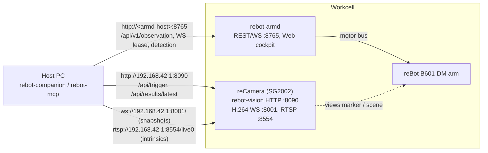

# rebot-companion

<div align="center">

### 🤖 Robot Arm Vision Companion Toolkit & MCP Server for AI Agents

**Control a reBot arm from AI agents over MCP, with reCamera snapshots, detections and hand-eye calibration**

[](https://www.python.org/)
[](LICENSE)
[](https://modelcontextprotocol.io)
[](https://github.com/Seeed-Solution/rebot-companion/actions)
[](https://github.com/Seeed-Solution/rebot-armd)
[](https://www.seeedstudio.com)

English | [中文](./README.zh-CN.md)

<!-- TODO: Add demo GIF of AI Agent controlling the arm and camera via MCP here -->

</div>

---

Python SDK and stdio [MCP](https://modelcontextprotocol.io) server bridging **Seeed reCamera (SG2002 RISC-V edge vision)** and **[rebot-armd](https://github.com/Seeed-Solution/rebot-armd) (Rust arm daemon)**.

- `rebot` (arm-control core): standard library only, Python >= 3.8. The `Arm` class for short programs meant to run unchanged on a PC and on the reCamera (see [Write your own program](#write-your-own-program)), plus the armd protocol client and detection access underneath it.
- `rebot_companion` (SDK): rebot-armd client (re-exported from `rebot`) (REST reads, WebSocket control lease, joint and Cartesian actions), reCamera ArUco trigger client, JPEG snapshots from the camera H.264 stream, B601-DM kinematics, hand-eye calibration, and a deterministic pick-and-place pipeline.
- `rebot-mcp`: a stdio [MCP](https://modelcontextprotocol.io) server that exposes the arm, snapshots and detections as tools to AI agents.

## Key Features

- **Stdio MCP server for AI agents (`rebot-mcp`)**: 24 tools by default (state, snapshots, detection, motion, gripper, stop, named poses, place, keep-out boxes, fault recovery, collision guard, safety description). Works with MCP clients that support stdio servers; end-to-end tests used the Python `mcp` client against a real arm. Fault clearing and cockpit takeover are off unless enabled at launch (see [MCP server](#mcp-server-agent-control)).
- **Hand-eye calibration**: eye-to-hand (closed-form Horn point registration) and eye-in-hand (Park & Martin $AX=XB$), cross-checked against OpenCV `CALIB_HAND_EYE_PARK` in the tests. Accuracy is verified on synthetic data only; it has not been measured on a real arm yet.
- **Two stages**: Stage 1, an agent orchestrates the tools; Stage 2, a deterministic local pick-and-place pipeline that needs no LLM.
- **Kinematics**: full URDF forward kinematics (within 0.1 mm of an independent URDF parser in the tests) and an analytic planar inverse kinematics solver for the B601-DM.
- **reCamera integration**: `rebot_companion` and the MCP server run on a host; the `rebot` package (standard library only) is meant to run on the camera as well (not yet run on the device). On-demand detection triggers (6-DoF ArUco marker poses, YOLO 2D boxes) and JPEG snapshots decoded on the host from the camera's H.264 stream.

> This software moves a real arm. Read [Safety](#safety) before running anything that moves.

---

## Contents

- [Key Features](#key-features)
- [Architecture](#architecture)
- [Requirements](#requirements)
- [Install](#install)
- [Quickstart](#quickstart)
- [Write your own program](#write-your-own-program)
- [Project layout](#project-layout)
- [Topology](#topology)
- [Arm control](#arm-control)
- [MCP server (agent control)](#mcp-server-agent-control)
- [Hand-eye calibration](#hand-eye-calibration)
- [Camera intrinsics](#camera-intrinsics)
- [Record a LeRobot dataset](#record-a-lerobot-dataset)
- [Run a learned policy](#run-a-learned-policy)
- [Examples](#examples)
- [Safety](#safety)
- [Development](#development)
- [Acknowledgements](#acknowledgements)
- [License](#license)

---

## Architecture

```text
┌────────────────────────────────────────────────────────────┐
│ Host PC: rebot-companion (Python)                          │
│  Stage 1: agent / script orchestration (rebot-mcp, ex. 03) │
│  Stage 2: deterministic pipeline (pipeline.py, ex. 04)     │
└───────────────────────────┬────────────────────────────────┘
                            │ HTTP / WebSocket
                            ▼
┌──────────────────────────────┬─────────────────────────────┐
│ rebot-armd (arm daemon)      │ reCamera services           │
│ REST + WS lease  :8765       │ rebot-vision HTTP    :8090  │
│ actions, limits, watchdog    │ H.264 WebSocket      :8001  │
│ detection API /api/v1/...    │ RTSP /live0          :8554  │
└──────────────────────────────┴─────────────────────────────┘
```

The SDK does not run on the camera. The camera and armd provide single-purpose endpoints:

- `POST /api/trigger` (rebot-vision, :8090): one detection, returns marker poses
  (`x, y, z, roll, pitch, yaw`).
- `ws://<host>:8001/`: H.264 stream; `rebot_companion.snapshot` decodes one IDR frame to JPEG.
- `rtsp://<host>:8554/live0` (1280x720): used by the intrinsics tool.
- There is no HTTP snapshot endpoint on the device (`:80/snapshot.jpg` redirects to the
  supervisor UI). `ReCameraClient.get_snapshot()` works only when `snapshot_url=` is passed.
- `/api/v1/detection/*` on armd: object detection (`detect` / `snapshot_annotated` tools).

Two stages:

- **Stage 1**: an agent (through `rebot-mcp`) or a host script calls these APIs and decides
  what to do next.
- **Stage 2**: once calibration, poses and pick parameters are fixed, `DeterministicPickPlacePipeline`
  runs the cycle without an LLM: trigger, transform, workspace check, leased motion.

---

## Requirements

Hardware:

- reBot B601-DM arm (armd uses a 7-joint vector: J1..J6 plus the gripper as index 6).
- Seeed reCamera. The defaults assume the USB network address `192.168.42.1`.
- An ArUco marker on the gripper (eye-to-hand) or in the scene (eye-in-hand) for hand-eye
  calibration and the pick pipeline.

Software on the devices:

- rebot-armd, reachable over HTTP/WebSocket (default port 8765). The Cartesian move, gripper
  and action-status features need an armd build that serves `/api/v1/action/*` and reports
  `action` in the observation; `home` / `park` also work with older builds.
- `rebot-vision` on the reCamera for marker triggers (part of the `rebot-teleop` package, which
  also carries rebot-armd; no separate camera app is needed). The camera's own aruco-detector
  also works: its trigger needs a JSON body (aruco-detector >= 0.1.3 answers `415` otherwise;
  the SDK sends one) and distortion keys need aruco-detector >= 0.1.1.
- The SenseCraft solution `rebot_agent_arm` installs `rebot-teleop`, this MCP server and the
  calibration verify step.
- `rebot` on the reCamera (the package targets Python 3.8 there) does not come from this project's
  wheel, which requires Python >= 3.10. A rebot-teleop deb built with
  `REBOT_SDK_DIR=<rebot-companion checkout>` carries the `rebot/` folder in
  `/usr/share/rebot-teleop/python`, and its app runner puts that directory on `PYTHONPATH`.
  Without it, copy the `rebot/` folder next to the program's `main.py`.

Host:

- Python >= 3.10 and [uv](https://docs.astral.sh/uv/) for `rebot_companion` and the MCP server.
  The `rebot` package alone needs Python >= 3.8 and no third-party packages.
- Snapshots: PyAV (in the `agent` extra) or the `ffmpeg` binary on `PATH`.
- Optional: Node.js, only to regenerate the JS reference values for the tests.

---

## Install

```bash
git clone https://github.com/Seeed-Solution/rebot-companion
cd rebot-companion
uv sync                      # SDK only
uv sync --extra agent        # + MCP server: mcp 2.x, av, pillow
uv sync --extra calib        # + OpenCV for tools/calibrate_intrinsics.py
uv sync --extra record       # + PyAV, pyarrow for rebot-record
uv sync --extra policy       # + PyAV, pyarrow for rebot-policy (learned policies: see Run a learned policy)
uv sync --all-extras         # everything (development)
```

| Extra | Packages | Needed for |
|---|---|---|
| `agent` | `mcp>=2.3,<3`, `av>=12`, `pillow>=10` | `rebot-mcp`, snapshots with PyAV, annotated snapshots |
| `calib` | `opencv-python-headless>=4.8,<5` | camera intrinsics tool |
| `record` | `av>=12`, `pyarrow>=14` | `rebot-record` (LeRobot dataset recorder) |
| `policy` | `av>=12`, `pyarrow>=14` | `rebot-policy` (camera, scripted policies); torch and lerobot are installed separately |

The test suite runs against the versions pinned in `uv.lock` (for example mcp 2.3.0).

---

## Quickstart

Connect to armd, read the state, grab a snapshot, make a small move and park. Run it with
`uv run --extra agent python quickstart.py`. Keep the arm's workspace clear.

```python
from rebot_companion import ArmdClient
from rebot_companion.snapshot import snapshot_once

arm = ArmdClient("http://192.168.42.1:8765")

# 1. State (REST, no lease needed). The MCP tool get_state returns the same data plus the host FK pose.
obs = arm.get_observation()
print(obs.safety_state, obs.is_torqued, [round(q, 3) for q in obs.positions])

# 2. Snapshot: waits for the next IDR frame on the camera stream (timeout 6 s).
snap = snapshot_once("ws://192.168.42.1:8001/", max_width=800)
open("snapshot.jpg", "wb").write(snap.jpeg)

# 3. Small move and park, inside a control lease (heartbeat every 150 ms).
with arm.session() as s:
    s.torque(True)
    s.home_action()
    s.move_relative("base", (0.0, 0.0, 0.02))  # 2 cm up in the base frame; needs the action API
    s.park_action()  # resting pose, then torque off
```

The arm part of this sequence is checked against the fake armd used by the tests
(`tests/fake_armd.py`), not on hardware. Without the action API, use the joint-space calls instead: `s.home()`, `s.move_to(q, duration=2.0)`,
`s.unload()` (see [Arm control](#arm-control)).

---

## Write your own program

`rebot` is the part of the SDK for your own scripts. It imports only the Python standard library,
so the same script runs on a PC (arm over the network) and on the reCamera (`127.0.0.1`).

```python
from rebot import Arm

with Arm() as arm:  # $REBOT_HOST, else 127.0.0.1; takes control, torque on
    arm.home()
    for obj in arm.detect("cup"):  # detections, best first: label, score, box_norm
        if arm.grasp(obj).holding:
            arm.move_to((0.25, -0.15, 0.15))  # metres, arm base frame (x forward, y left, z up)
            arm.gripper_open()
        break
# Leaving the block parks the arm (torque off) and releases control,
# also after an error or Ctrl+C.
```

Run on a PC (the `rebot/` folder next to the script, or the package installed with `uv sync`):

```bash
REBOT_HOST=192.168.42.1 python3 main.py
```

Run on the reCamera: copy the `rebot/` folder and the script to the device, then run it with the
device's `python3`:

```bash
scp -r rebot main.py <user>@192.168.42.1:~/arm/
ssh <user>@192.168.42.1 'cd ~/arm && python3 main.py'
```

| Method | What it does |
|---|---|
| `Arm(host=None, port=None, enable=True, park_on_exit=True, force=False, obs_hz=10, handle_sigterm=True)` | connect, take the control lease, turn torque on |
| `home()`, `park()` | move home; move to the resting pose and turn torque off (the next motion turns torque on again) |
| `move_to(xyz, rpy=None, speed=None)` | straight-line move of the gripper; `rpy` in radians, `speed` in m/s |
| `move_relative(dx, dy, dz, frame="base", droll, dpitch, dyaw, speed)` | relative move in the `base`, `tool` or `camera` frame |
| `move_joints(positions, duration=None)` | joint-space move (7 values, radians) |
| `gripper_open()`, `gripper_close()`, `gripper_move(fraction)` | gripper; `gripper_close().holding` reports a held object |
| `detect(label=None, pipelines=("yolo",), min_score=0.3)` | one detector run through armd; list of detections |
| `grasp(detection)` or `grasp("cup", box=(x0, y0, x1, y1))` | armd's grasp action; `.holding` in the result |
| `state()` | latest observation (`positions`, `safety_state`, `is_torqued`, `fault`, ...) |
| `poses()`, `save_pose(name)`, `delete_pose(name)`, `move_to_pose(name, speed_scale=1.0)` | named poses stored in armd |
| `place(pose=None, position=None, rpy=None, approach_height_m=0.08, release=True, retreat=True, speed_scale=1.0)` | put the held object down: lift, approach, descend, open, retreat (capability `place`) |
| `stop()`, `e_stop()` | stop and hold; latched emergency stop |
| `wait_until_clear(timeout_s=10)` | after a `COLLISION` action failure: block until the arm has resumed (capability `collision_guard`) |
| `set_collision_guard(enabled=None, sensitivity=None)`, `collision_guard()` | switch the collision guard, set `"low"`/`"medium"`/`"high"`, read its configuration (capability `collision_guard`) |
| `recover(max_attempts=1)` | clear a fault that armd marks recoverable, then torque on |
| `guard(timeout_s)`, `feed()` | release control when the main loop stops calling `feed()` |

Starting points: `examples/templates/sort_by_label.py` (YOLO detection, grasp, place into bins chosen by
label) and `examples/templates/demo_wave.py` (tour of three taught poses). Building a program with an AI
assistant: see [AGENTS.md](AGENTS.md) (workflow, API cheat sheet, safety rules, error codes).

Behaviour:

- `Arm` turns SIGTERM into `SystemExit` in the main thread (`handle_sigterm=False` opts out), so the
  device app runner's stop signal parks the arm and releases control.
- Errors are `rebot.RebotError` subclasses with `.code` and `.message`, for example
  `IK_BRANCH_FLIP: target (0.9, 0, 0.1) needs the arm to flip its elbow; choose a closer or higher
  target (...)` (this text is from the integration test below).
- `recover()` clears only faults whose observation `fault.recoverable` is true (watchdog timeout,
  control deadline, unsettled handover). E-stops, other faults, and every fault on an armd without
  fault codes raise `ArmFaultError`; clear those in the web cockpit after checking the arm. Leaving
  the `with` block does not clear them either.
- `guard(timeout_s)`: a background thread releases the lease when `feed()` has not been called
  for `timeout_s` seconds (time inside an `Arm` method counts as fed, up to that call's own timeout
  plus 15 s: motions `timeout` or 60 s, other calls 30 s); armd's lease watchdog then handles the
  arm, and every later call raises `GuardTimeout`.
- Named poses, `move_to_pose`, `obs_hz` and fault codes need an armd that reports capabilities
  version 6 (`poses`, `obs_rate`, `fault_codes`). Against older armd the pose methods raise
  `UnsupportedError` (`code == "UNSUPPORTED"`), `obs_hz` is not sent (armd then sends every
  control tick), and `recover()` does not clear faults.

What was checked:

- `import rebot` loads no third-party module (`numpy`, `httpx`, `websockets` stay out of
  `sys.modules`). The `rebot` unit tests (WebSocket client, facade, protocol) pass on CPython 3.8.20
  and 3.13 against the in-process fake armd; CI runs them on 3.8 (job `stdlib-core`). The
  reCamera's `python3` version was not checked; it has to be 3.8 or newer.
- `tests/test_integration_armd.py` drives `Arm` against an armd binary built from rebot-armd
  `ad923df` with `--follower mock` and the B601-DM profile: connect, enable, `move_to`, `home`,
  `park`, release, park on exit, readable errors. That armd reports capabilities version 5, so the
  version 6 features were checked only against the fake armd. Not run on hardware.

```bash
ARMD_BIN=/path/to/armd ARMD_PROFILE=/path/to/rebot-b601dm.json uv run pytest tests/test_integration_armd.py -s
```

---

## Project layout

```text
rebot-companion/
├── pyproject.toml              # uv project; extras: [agent] = MCP server, [calib] = OpenCV
├── rebot/                      # arm-control core, standard library only (Python >= 3.8)
│   ├── arm.py                  # Arm facade for user programs
│   ├── client.py               # rebot-armd client (REST reads + WebSocket lease session + actions)
│   ├── detection.py            # detections through armd's detector proxy
│   ├── errors.py               # RebotError and subclasses
│   ├── _ws.py                  # minimal RFC 6455 WebSocket client
│   └── _http.py                # JSON over urllib
├── rebot_companion/            # SDK (numpy / scipy)
│   ├── arm_client.py           # re-export of rebot.client
│   ├── camera_client.py        # reCamera rebot-vision / aruco-detector client (trigger / latest result)
│   ├── snapshot.py             # JPEG snapshots from the H.264 stream + detection overlay
│   ├── lerobot_recorder.py     # LeRobot v3.0 dataset recorder (rebot-record)
│   ├── policy_runner.py        # LeRobot / scripted policy -> armd servo stream (rebot-policy)
│   ├── mcp_server.py           # stdio MCP server (rebot-mcp)
│   ├── kinematics.py           # B601-DM FK (full URDF chain) and planar FK/IK (port of the Web cockpit)
│   ├── ik.py                   # IK adapter: base-frame pose -> armd 7-joint vector (incl. gripper)
│   ├── transforms.py           # SE(3) transforms, Euler ZYX convention
│   ├── calibration.py          # hand-eye calibration: point registration + AX=XB
│   └── pipeline.py             # Stage 2 deterministic pick & place
├── examples/                   # see "Examples"
├── tools/
│   ├── calibrate_intrinsics.py # camera intrinsics + distortion (OpenCV)
│   └── gen_web_fixtures.mjs    # regenerates JS reference values for the tests
└── tests/
```

---

## Topology



Default addresses:

| Component | `rebot-mcp` default | Examples default |
|---|---|---|
| rebot-armd | `http://192.168.42.1:8765` (armd on the reCamera) | `http://127.0.0.1:8765` (pass `--arm-url`) |
| camera H.264 stream | `ws://192.168.42.1:8001/` | — |
| rebot-vision (`:8090`) | — | `http://192.168.42.1:8090` |

---

## Arm control

rebot-armd accepts actuator commands only on the WebSocket connection that holds the control
lease; REST `motion/*`, torque and `clear_fault` return `LEASE_REQUIRED`.

- Read state without a lease: `ArmdClient.get_observation()` / `ArmdClient.get_schema()`.
- Move inside `with arm.session() as s:` (acquires the lease, heartbeats every 150 ms; armd's
  default lease timeout is 2500 ms):
  `s.torque(True)`, `s.home()`, `s.move_to(q, duration=2.0)` (blocks until arrival),
  `s.servo_stream(frames, rate_hz=50)`, `s.unload()`.
- `ArmdClient.e_stop()` works without a lease.
- If the arm is still torqued when the lease expires, armd's watchdog acts. In the rebot-armd
  source checked for this README (commit `5aba3d5`), it parks the arm and turns torque off when
  the arm is healthy and has a resting pose; otherwise it holds position with torque on and
  latches `Fault(WatchdogTimeout)`. Older armd builds only hold and latch. Finish with
  `s.unload()`, or after a fault call `s.clear_fault()` then `s.torque(True)`.
- Safe exit: `arm.session(safe_exit="error")` (default) unloads a torqued arm when the `with`
  block raises (including Ctrl-C): clear a Fault, re-arm, `unload(wait=True)` bounded by
  `safe_exit_timeout` (30 s), then release the lease. `safe_exit="always"` also does this on a
  normal exit; `"off"` only releases. The result is in `s.safe_exit_outcome` (`unloaded`,
  `not_needed`, `unsupported`, `estop`, `no_lease`, `failed`). A latched EStop is not cleared.
  When armd has no resting-pose profile, `unload` answers `UNSUPPORTED`; the outcome is
  `unsupported` and the arm stays torqued.
- `s.torque(False)` is refused by armd (`ARM_NOT_AT_RESTING_POSE`) unless the arm is settled at
  the resting pose; use `s.unload()`.
- `s.unload()` raises `UnloadFailed` as soon as armd reports `Armed` with torque on after the
  unload motion (failed torque cut). After `s.unload(wait=False)`, closing the session waits for
  the unload, because a lease release cancels it in armd.
- Servo: `servo_stream()` needs `rate_hz >= 10` (armd drops the stream 200 ms after the last
  frame). armd drops frames that jump more than 0.35 rad from its commanded position without a
  reply (gripper exempt); `servo()` raises `ServoJumpError` for such a step instead of sending it.
- After a `force=True` preemption, armd refuses motion with `HANDOVER_SETTLING` for a short
  settling period.
- Actions (armd with `/api/v1/action/*`): `s.move_pose(xyz, rpy=None | quat=None)` (straight-line
  Cartesian move of `end_link`; `move_to` stays the joint-space jog),
  `s.move_relative(frame, d, dyaw=, dpitch=, droll=)`, `s.gripper("open" | "close" | "move", fraction=)`,
  `s.home_action()`, `s.park_action()`, or `s.action(path, body)`. Each blocks until
  `observation.action` with the ack's `action_id` is terminal and returns an `ActionResult`;
  `failed` / `cancelled` raise `ActionFailed(code)`. The default timeout is
  `2 * expected_duration_s + 5` s, capped at 60 s; on timeout `stop` is sent and `MotionTimeout`
  raised. `ArmStatus.commanded_positions` and `ArmStatus.action` are empty / None on an armd
  without these fields.

```python
from rebot_companion import ArmdClient

arm = ArmdClient("http://127.0.0.1:8765")
with arm.session() as s:
    s.torque(True)
    target = list(s.home().positions)  # keep home J6 (pi/2) and the gripper
    target[0] += 0.2  # J1 +0.2 rad from home
    s.move_to(target, duration=2.0)
    s.unload()  # park + torque off before the lease is released
```

Marker trigger (`ReCameraClient`): `trigger()` posts a JSON body; a `415` raises `CameraError`.
It raises `CameraTriggerTimeout` on an HTTP timeout or a `success: false` reply; an empty list
means the frame had no marker. Markers without a `pose` are skipped.

---

## MCP server (agent control)

`rebot_companion/mcp_server.py` is a stdio MCP server. It needs the `agent` extra.

```bash
uv run --directory /path/to/rebot-companion --extra agent rebot-mcp \
  --armd http://192.168.42.1:8765 --camera-ws ws://192.168.42.1:8001/ \
  [--client-id rebot-mcp] [--no-auto-lease] [--decoder auto|pyav|ffmpeg] \
  [--allow-clear-fault] [--allow-preempt] [--log-level INFO]
```

### Agent Integration (MCP Clients)

#### Generic MCP configuration (clients that use `mcpServers`, e.g. Claude Desktop `claude_desktop_config.json`, Cursor, Windsurf)

Add `rebot` to the `mcpServers` object in your agent's MCP configuration:

```json
{
  "mcpServers": {
    "rebot": {
      "command": "uv",
      "args": [
        "run",
        "--directory", "/path/to/rebot-companion",
        "--extra", "agent",
        "rebot-mcp",
        "--armd", "http://192.168.42.1:8765"
      ]
    }
  }
}
```

The camera stream defaults to `ws://192.168.42.1:8001/`; add `"--camera-ws", "ws://<host>:8001/"` when the reCamera has another address. Clients with a different config format (for example OpenCode) need the same command and arguments in their own format.

#### Claude Code CLI

```bash
claude mcp add rebot -- uv run --directory /path/to/rebot-companion --extra agent rebot-mcp \
  --armd http://192.168.42.1:8765
```

Logs go to stderr; stdout is the MCP channel.

| Flag | Default | Effect |
|---|---|---|
| `--armd` | `http://192.168.42.1:8765` | rebot-armd base URL (arm and detection API) |
| `--camera-ws` | `ws://192.168.42.1:8001/` | camera H.264 stream for snapshots |
| `--client-id` | `rebot-mcp` | lease label shown to other clients |
| `--no-auto-lease` | off | do not acquire the lease until `take_control` |
| `--decoder` | `auto` | `pyav`, `ffmpeg`, or `auto` (PyAV if installed) |
| `--allow-clear-fault` | **off** | adds the `clear_fault` tool |
| `--allow-preempt` | **off** | adds `force` to `take_control` (take control from the web cockpit) |

Tools:

| Tool | Input | Result |
|---|---|---|
| `get_state` | — | safety state, fault, torque, lease, joints (positions / commanded / velocities / torques / temperatures), `tcp` (host FK: `xyz_m`, `rpy_deg`, `quat` [w,x,y,z]), gripper, latest `action`, `epoch_id`. No lease needed |
| `snapshot` | `max_width` (800, 64..1920), `quality` (80, 10..95) | JPEG image + JSON `{width, height, device_ts_ms, age_ms}` |
| `snapshot_annotated` | `min_score` (0.3), `max_width`, `quality` | JPEG with the latest detector boxes + JSON `{detections, det_frame_id, det_age_vs_frame_ms, note?}` |
| `detect` | `wait_ms` (2500, 0..5000), `min_score` (0.3), `pipelines` (`yolo` / `aruco` / `both`, default both) | `{frame_id, ts_ms, pipelines, count, detections[{label, score, box_norm, center_norm, track_id}]}`; uses `POST /api/v1/detection/trigger` with `{"pipelines": [...]}` when the detector reports `per_request_pipelines` (rebot-vision >= 1.3, perception API 2); older detectors run their current mode and `pipelines` in the result is null; on 404: enable inference → `latest` → disable (only if it enabled inference) |
| `move_to` | `x, y, z` (m), `roll_deg/pitch_deg/yaw_deg` or `quat`, `speed_mps` (≤ 0.15, default 0.05), `timeout_s` (≤ 60) | `{action_id, state, settled, tcp_after, duration_s}`; straight line of `end_link`; orientation omitted = keep |
| `move_relative` | `frame` (`base`/`tool`/`camera`), `dx/dy/dz` (each ≤ 0.30 m), `dyaw_deg/dpitch_deg/droll_deg` (each ≤ 90), `level`, `speed_mps` | same as `move_to` |
| `gripper` | `command` (`open`/`close`/`move`), `fraction` (0 closed .. 1 open), `grasp` | `{holding, gap_rad, torque_nm, fraction, state}` |
| `home` / `park` | — | action result; `park` ends Idle with torque off |
| `stop` | — | `{state}`; runs while another tool is moving |
| `e_stop` | — | `{safety_state, epoch_id}`; no lease needed |
| `enable` | — | torque on |
| `list_poses` | — | `{count, poses[{name, positions, tcp}]}`; no lease needed. Needs armd capability `poses` |
| `save_pose` | `name` (letters, digits, `_`, `-`; max 64) | saves the current joint positions under `name`, replacing a pose of that name. Changes the device's saved poses. Capability `poses` |
| `move_to_pose` | `name`, `speed_scale` (0.1..1.0, default 0.5) | action result; joint-space move. Capability `poses` |
| `place` | `pose` or `x, y, z`; `rpy_deg`, `approach_height_m` (0.08, 0.02..0.30), `release`, `retreat`, `speed_scale` (0.5), `timeout_s` | action result; lift, approach, descend, open, retreat. Capability `place` |
| `get_keepout` | — | `{boxes[{name, min_m, max_m}], source}`; no lease needed. Capability `keepout` |
| `set_keepout` | `boxes` (max 16) | replaces the runtime keep-out boxes (`[]` removes them). Changes the device configuration. Capability `keepout` |
| `recover` | — | clears a fault armd marks recoverable (`WATCHDOG_TIMEOUT`, `CONTROL_DEADLINE`, `HANDOVER_UNSETTLED`) and re-enables torque; any other fault or E-stop returns `NOT_RECOVERABLE` and stays latched. Capability `fault_codes` |
| `collision_guard_status` | — | `{enabled, sensitivity, thresholds_nm}`; no lease needed. `get_state.collision` shows a stop in progress. Capability `collision_guard` |
| `describe_safety` | — | stops, faults (with `recoverable`), speed and joint limits, timing, `hardware.physical_estop`, plus a one-line `summary`; no lease needed. Capability `safety_describe` |
| `set_collision_guard` | `enabled`, `sensitivity` (`low`/`medium`/`high`) | switches the collision guard and/or sets its sensitivity. Changes the device configuration. Capability `collision_guard` |
| `clear_fault` | — | clear EStop or Fault; listed only with `--allow-clear-fault` |
| `take_control` | `force` (only with `--allow-preempt`) | acquire a free lease; with `--allow-preempt`, `force=true` takes control from the web cockpit |
| `release_control` | — | release the lease; if the arm is torqued, armd's watchdog parks it |

`save_pose` and `set_keepout` write to the device (poses and keep-out files) and are registered by default.
Tools that need a capability return `UNSUPPORTED` with the message "Update rebot-armd" when armd is older.
`recover` never clears an E-stop or a fault armd marks not recoverable (including a `COLLISION` fault), so it does not need `--allow-clear-fault`.
`save_pose`, `set_keepout` and `set_collision_guard` write to the device; use them when the user asks.

Collision guard: with the guard on, contact makes armd stop the arm and hold it. Running actions fail with `COLLISION`, motion commands are refused with `COLLISION_HOLD`, and the arm resumes by itself when the contact is gone. After repeated trips within a minute armd latches a `COLLISION` fault that a person clears in the cockpit. The guard is off by default and its thresholds are uncalibrated placeholders (not measured on a real arm). Both example templates wait with `wait_until_clear()` and retry the step once.

The limits in the table (speed ≤ 0.15 m/s, step ≤ 0.30 m, rotation ≤ 90 deg) are checked by
the server's input schema before a call reaches armd; armd applies its own limits as well.

Lease and safety rules:

- At startup the server tries a non-force lease. If the web cockpit or another client holds it,
  the server keeps running without it and actuator tools return `LEASE_BUSY`; each actuator
  call retries a non-force acquire. The server never sends `force=true` by itself.
- While the server holds the lease, its 150 ms heartbeat keeps it; the cockpit's non-force
  retry does not take it over.
- If the cockpit preempts (its confirm button), tools return `LEASE_LOST`. The server does not
  re-acquire; control comes back only through `take_control`.
- **By default the agent cannot take control from the cockpit or clear faults**: `take_control`
  has no `force` parameter and `clear_fault` is not listed. After an E-stop or fault, error
  hints tell the agent to ask a person to clear it in the web cockpit.
  - `--allow-preempt` adds `take_control(force=true)`. The server instructions tell the agent to
    use it only after the user explicitly confirms. Inside armd's cooldown it returns
    `PREEMPT_COOLDOWN` with `remaining_ms`.
  - `--allow-clear-fault` adds the `clear_fault` tool.
- The cockpit takes the lease on its first control input, not when the page opens, and releases it
  after 30 s without input only while torque is off. With no cockpit holding the lease, `take_control`
  succeeds without `force`. A cockpit with torque on keeps the lease: the user turns torque off in the
  cockpit (the lease is released after 30 s idle), or the server runs with `--allow-preempt`. While the
  server holds the lease, the cockpit shows observer mode and names the holder (the `--client-id` label).
- After `release_control`, or with `--no-auto-lease`, tools return `NO_LEASE` until `take_control`.
- One motion tool runs at a time; a second call returns `BUSY`. `stop` and `e_stop` run at any time.
  If the MCP client cancels a motion call, the server sends `stop`.
- On exit the session releases the lease; on an exception (including Ctrl-C) `safe_exit="error"`
  parks the arm first. If the process is killed, armd's lease watchdog acts (see
  [Arm control](#arm-control)).

Errors come back as `isError` results whose text is JSON `{code, message, hint, safety_state}`;
codes include `LEASE_BUSY`, `LEASE_LOST`, `NO_LEASE`, `ESTOP_ACTIVE`, `FAULT_ACTIVE`,
`NOT_ARMED`, `WORKSPACE_VIOLATION`, `IK_UNREACHABLE`, `IK_BRANCH_FLIP`, `MOTION_BUSY`,
`MOTION_TIMEOUT` (stop was sent), `TRACKING_STALL`, `STOPPED`, `SUPERSEDED`, `BUSY`,
`CAMERA_UNAVAILABLE`, `SNAPSHOT_TIMEOUT`, `DETECTOR_UNAVAILABLE`, `UNSUPPORTED`.

Snapshots wait for the next IDR frame on the camera stream (default timeout 6 s), decoded with
PyAV or, without it, the `ffmpeg` binary. Box positions are normalised to the image; they are
only correct when the detector input has the same aspect ratio as the stream (not verified on
the device).

---

## Hand-eye calibration

### Forward kinematics (B601-DM)

`rebot_companion.kinematics` has two models, both in the URDF base frame (x forward, y left,
z up, metres / radians):

- Full FK, `tcp_pose(q)` / `tcp_pose_from_joints(positions)` / `calibration.gripper_pose(positions)`:
  the URDF chain `base_link` → `joint1`..`joint6` → `end_joint` → `end_link` of
  `reBot-DevArm_gripper.urdf` (rebot-armd `assets/`, copy in `tests/fixtures/`). Returns the
  SE(3) TCP pose, x axis = tool axis. Hand-eye calibration uses this FK, so J5 and J6 may take
  any value in the samples. Tests compare it with an independent URDF parser: < 0.1 mm, < 0.01 deg.
- URDF joint5 = wrist swing (axis vertical at the park pose J1..J5 = 0, J6 = pi/2; +0.2 rad
  moves the TCP ~36 mm in -y), joint6 = tool roll (about the tool axis; the TCP position does
  not change). The Web cockpit UI uses the same labels (J5 swing, J6 roll).
- Motor → URDF mapping: armd index 0..3 → URDF joint1..joint4 with `model = (motor - offset) / sign`
  (Web `toModel` / `CFG.cart.sign` / `CFG.cart.off`, defaults sign `1,1,1,1`, offset `0`; same as
  the Web `?iksign=` / `?ikoff=` overrides; the wizard takes `--iksign` / `--ikoff`). Index 4 →
  joint5 and index 5 → joint6, 1:1. Index 6 (gripper) is not part of the FK.
- Planar FK/IK, `fk(q)` / `solve_ik(target, prev)`: line-by-line port of the rebot-armd Web
  cockpit (`src/api/index.html`, `IK.fk` / `IK.solve`), J1 yaw + J2/J3/J4 pitch chain, J5 = 0.
  Tests compare it against values computed by running the JS code with node
  (`tools/gen_web_fixtures.mjs`). With J5 = 0 its TCP position matches the full FK to < 0.2 mm
  (rounded Web constants, joint1 x offset of -0.084 mm ignored).
- `solve_ik(target, prev)` is the analytic position + pitch IK from the Web.
- `ik.B601IkAdapter` fills J1–J4 from the analytic IK (tool pointing down by default), J5 = 0,
  J6 = armd home (pi/2) or the current value (`j6=None`), J7 = gripper. armd rejects targets
  with any other length.

### Methods and assumptions

| `method` | Setup | Assumption | Uses | Result |
|---|---|---|---|---|
| `point` (default) | eye_to_hand | marker centre coincides with the TCP | positions only | `T_cam_to_base` (Horn closed form, same as the Web `solveRigid`) |
| `axxb` | eye_to_hand | marker rigid on the gripper, offset unknown | full poses | `T_cam_to_base` + `T_marker_to_gripper` |
| `axxb` | eye_in_hand | camera on the gripper, marker fixed in the scene | full poses | `T_cam_to_gripper` + `T_marker_to_base` |

- `axxb` = Park & Martin: rotation by least squares on rotation logarithms, translation by
  stacked linear least squares, over all sample pairs. Its result matches
  `cv2.calibrateHandEye(..., CALIB_HAND_EYE_PARK)` in the tests.
- `axxb` needs relative rotations about at least two non-parallel axes. With this arm, change
  both J1 yaw and wrist pitch (>= 15 deg) between samples; J5 swing and J6 roll add further
  rotation axes. Rotation about one axis only, or < 5 deg, raises `CalibrationError`.
- Residuals: `point` reports the 3D point error per sample; `axxb` reports per-sample marker
  position (m) and rotation (deg) prediction errors in the camera frame. RMSE and max error are
  printed and saved. The wizard warns when the RMSE is above 10 mm.
- Marker orientation from the device has 0.01 deg resolution (`r_deg`, 2 decimals). `point`
  does not use it.
- Accuracy depends on the camera intrinsics and `MARKER_SIZE` on the device. Calibrate
  intrinsics first ([Camera intrinsics](#camera-intrinsics)).

### Wizard

```bash
# eye-to-hand, marker centre on the TCP (default)
uv run python examples/02_hand_eye_calib.py --arm-url http://<armd-host>:8765 --marker-id 0
# marker anywhere on the gripper
uv run python examples/02_hand_eye_calib.py --method axxb --arm-url http://<armd-host>:8765
# re-solve samples exported from the Web cockpit
uv run python examples/02_hand_eye_calib.py --from-web-export rebot_hand_eye_2026-11-01T10-00-00.json
```

Pose the arm by hand (torque off) or with teleop, hold it still and press Enter. Each capture
checks that the arm is not moving (|v| <= 0.02 rad/s, `--vel-threshold`, re-checked after
detection), triggers one detection, picks the marker id, computes the TCP pose with FK, rejects
samples closer than 10 mm to an existing one and appends to `calib_samples.json` (`--resume`
continues a session). `s` solves and prints the residual table, `d` solves and writes
`calibration.json`.

### Calibration file format

`save_to_file()` writes a superset of the Web cockpit export, so files from either side load
with `HandEyeCalibration.load_result()` (returns `HandEyeResult(setup, transform)`) and
`HandEyeCalibration.load_samples()` (returns samples to re-solve).

- `HandEyeResult.cam_to_base(joints)`: eye_to_hand returns `T_cam_to_base`; eye_in_hand returns
  `T_base_gripper(joints) @ T_cam_to_gripper`, with `joints` the armd positions when the image
  was taken. The pipeline reads them right before the trigger and fails the cycle if the arm
  moved during detection.
- `HandEyeCalibration.load_from_file()` returns `T_cam_to_base` for eye_to_hand files and raises
  `ValueError` for eye_in_hand files (their transform is `T_cam_to_gripper`).
- Legacy SDK files without `mode` / `setup` are rejected by `load_result()`.

```jsonc
{
  "version": 1, "kind": "hand_eye_calibration",
  "setup": "eye_to_hand",                    // or "eye_in_hand"
  "method": "point_registration_horn",       // or "axxb_park_martin"
  "assumption": "...", "units": {"length": "m", "angle": "deg"}, "created": "...", "marker_id": 0,
  "result": {
    "T_cam_to_base": [[...4x4...]],          // "T_cam_to_gripper" for eye_in_hand; p_target = T @ p_cam
    "translation_m": [x, y, z], "euler_rpy_deg": [roll, pitch, yaw],
    "euler_convention": "R = Rz(yaw) Ry(pitch) Rx(roll)",
    "rmse_m": 0.0012, "max_error_m": 0.0021, "residuals_m": [...], "samples": 9, "solved_at": "...",
    "rot_residuals_deg": [...], "rot_rmse_deg": 0.3,          // axxb only
    "T_marker_to_gripper": [[...]]                            // axxb only ("T_marker_to_base" for eye_in_hand)
  },
  "samples": [{"joints": [...], "p_base": [...], "p_cam": [...], "R_cam": [[...]], "rpy_cam_deg": [...],
               "marker_id": 0, "T_base_gripper": [[...]], "T_cam_marker": [[...]], "tcp_pitch": 0.5, "ts": "..."}],
  "transform": {"translation": [...], "euler_deg": [...], "matrix": [[...]]}   // legacy SDK block
}
```

The numbers in this example are illustrative. Web samples without `R_cam` are position-only
and can be solved with `method="point"` only. Their gripper rotation is recomputed from
`joints` with the FK.

---

## Camera intrinsics

The detector's default intrinsics are placeholders (fx = fy = 600, cx = 320, cy = 180 at
640x360, no distortion). `tools/calibrate_intrinsics.py` estimates K and distortion with OpenCV:

```bash
uv sync --extra calib
# live: frames from rtsp://192.168.42.1:8554/live0, auto-capture when the board is still and the view is new
uv run python tools/calibrate_intrinsics.py --host 192.168.42.1 --board checkerboard --cols 9 --rows 6 --square 0.025
# ChArUco board
uv run python tools/calibrate_intrinsics.py --board charuco --cols 7 --rows 5 --square 0.04 --marker 0.03 --dict DICT_4X4_50
# offline: re-run on saved frames
uv run python tools/calibrate_intrinsics.py --images intrinsics_frames/20261109-101500
```

1. Print the board flat; measure the square size. `--cols/--rows` are inner corners
   (checkerboard) or squares (ChArUco).
2. Move the board across the whole image, near and far, tilted in all directions; the tool
   captures a frame after the board is still for 5 frames and differs from earlier views
   (default 20 views, `--target`; frames are saved for offline re-runs).
3. The tool prints the reprojection RMS and writes `aruco-intrinsics.conf` with
   `CAMERA_WIDTH CAMERA_HEIGHT FX FY CX CY K1 K2 P1 P2 K3` (OpenCV order) at the inference
   resolution (`--infer-size`, default 640x360).
4. With `rebot-vision`: copy the values as lowercase keys (`fx fy cx cy k1 k2 p1 p2 k3`) into
   `/userdata/rebot-teleop/vision.json` and restart the app (`/etc/init.d/K92rebot-teleop restart`).
   With the camera's aruco-detector: merge the keys into `/etc/aruco-detector.conf` and restart it;
   the distortion keys need aruco-detector >= 0.1.1 and the file is preserved across upgrades.
   JSON replies carry `"undistorted": true/false`.

Resolution assumption: calibration runs on the 1280x720 RTSP stream, the detector infers at
640x360 from the same sensor. The tool assumes the same field of view (no crop) and scales fx,
fy, cx, cy by the width/height ratio (pixel-centre convention). This has not been verified on
the device; check a measured marker distance against a tape measure.

---

## Record a LeRobot dataset

`rebot-record` records teleoperation or scripted episodes from the host PC into a
[LeRobot](https://github.com/huggingface/lerobot) dataset (format `codebase_version` v3.0, as
written by `lerobot` 0.6.1; details in [`docs/lerobot_dataset.md`](docs/lerobot_dataset.md)).
It needs the `record` extra (PyAV, pyarrow), not lerobot.

```bash
uv sync --extra record
uv run rebot-record --armd 192.168.16.1 --camera 192.168.16.1 \
  --repo-id user/pick_cup --task "pick the cup" --episodes 5 --episode-s 30
```

Each episode: Enter starts it; Enter stops it early (otherwise it stops after `--episode-s`);
then Enter saves it, `d` discards it, `q` saves and quits. `--no-prompt` records back to back
(`--reset-s` pause between episodes). The dataset goes to
`~/.cache/huggingface/lerobot/<repo-id>` unless `--root` is given; the directory must be new.

| Feature | Source |
|---|---|
| `observation.state` (7) | armd `positions` (joints 1..6, gripper; rad) |
| `action` (7) | armd `commanded_positions` (falls back to `positions` on older armd) |
| `observation.velocity`, `observation.effort` (7) | `velocities`, `torques`, with `--extras velocity,effort` |
| `observation.images.recamera` | reCamera H.264 stream, decoded and re-encoded (libsvtav1 if PyAV has it, else h264; `g=2`, `crf=30`) |

The recorder does not take the control lease: it reads the armd observation WebSocket
(`/api/v1/ws?obs_hz=2*fps`) while a teleop app or program holds the lease. Alignment uses the
host receive time of every message (`time.monotonic()`): row `k` is due at `T0 + k/fps` and takes
the newest observation and the newest decoded camera frame received by then. armd's own
timestamp and the camera's ms tail are other clocks; they are stored per episode in
`meta/rebot_episodes.jsonl` with the observation and camera sample ages. Camera pipeline and
network delay are not compensated.

Python API: `LeRobotRecorder(root, repo_id, fps=30, camera_url=..., armd_host=..., task=...)`
with `start_episode()`, `stop_episode()`, `save()`, `discard()`; `start_episode(sample=False)`
plus `add_frame(state, action, image)` records scripted steps at a fixed `fps`.

Verified (`tests/test_lerobot_recorder.py`, synthetic observations and libx264 Annex-B frames
fed through the same PyAV decode path): file layout, indices, timestamps, stats and task
metadata; one mp4 frame per row; a lease-free run against the fake armd; the Enter-driven CLI.
`LeRobotDataset(repo_id, root=...)` loads the result and returns frames, actions and the task with
lerobot 0.6.1 (PyAV decoder) and 0.7.0 (torchcodec decoder) on Linux aarch64; this test runs
when `REBOT_LEROBOT_PYTHON` names a Python with `lerobot[dataset]` installed, else it is skipped.
Not yet run against a real armd and reCamera.

---

## Run a learned policy

`rebot-policy` runs a policy on the host PC (GPU host for learned policies) and drives the arm
through armd's servo stream. armd's servo guard (speed cap, lead cap, blocked hold), collision
guard and faults apply as for any other client.

```bash
# scripted policies, no torch: replay a recorded episode, or a small sine on one joint
uv run --extra policy rebot-policy --armd 127.0.0.1 --policy replay:$HOME/.cache/huggingface/lerobot/user/pick_cup:0
uv run --extra policy rebot-policy --armd 127.0.0.1 --policy sine:1:0.05:4 --max-seconds 20
# a LeRobot policy (local directory saved by lerobot-train, or a Hub repo id), on the real arm;
# torch + lerobot are added for this run only, in a Python 3.12 environment
uv run --python 3.12 --extra policy --with 'lerobot[dataset]>=0.6.1,<0.8' rebot-policy \
  --armd 192.168.16.1 --camera 192.168.16.1 --policy outputs/train/act/checkpoints/last/pretrained_model \
  --fps 30 --max-seconds 60 --task "pick the cup" --i-am-at-the-arm --log run.jsonl
```

torch and lerobot (0.6.1 or 0.7.0, Python >= 3.12, several GB) are not dependencies of
rebot-companion. Either add them per run with `uv run --with` as above (inside this repository
`--python 3.12` makes the project environment use Python 3.12), or install rebot-companion into
the Python environment where lerobot is already installed (for example the training environment).
The runner imports them only for a learned policy.

| Option | Meaning |
|---|---|
| `--policy` | LeRobot pretrained directory or Hub repo id; `replay:<dataset root>:<episode>` (the episode's `action` column); `sine:<joint>:<amp rad>:<period s>` (joint 1..7 or a name, amp <= 0.5 rad); a `scripted:` prefix is accepted; any other `<word>:` prefix is refused (not looked up on the Hub). The run prints whether a learned policy came from a local directory or the Hub |
| `--fps` | policy steps per second. Default: the dataset fps for `replay`; for a learned policy the fps in its `train_config.json` (`env.fps`, `dataset.fps`, else the training dataset's `meta/info.json` from `dataset.root` or `$HF_LEROBOT_HOME/<dataset.repo_id>`), and `--fps` is required when none is found; 30 for `sine`. A different `--fps` is logged as a warning |
| `--servo-hz` | servo frame rate (default 50, armd's control rate) |
| `--max-seconds` | run length (default 60) |
| `--max-steps` | stop after this many policy steps (default: no limit) |
| `--task` | task text passed to the policy (language-conditioned policies) |
| `--device` | torch device (default `cuda` when available, else `cpu`) |
| `--no-park` | hold position at the end instead of parking |
| `--stall-s`, `--max-frame-age`, `--max-obs-age` | stop when the policy gives no target for this long (default 1 s), the newest camera frame is older (default 0.5 s), or the newest armd observation is older (default max(0.1 s, 3 observation periods) at the rate armd sends: min of the requested 50 Hz, `timing.control_hz` and the rate measured at start; checked before every servo frame and policy step) |
| `--log` | per-step JSON lines (observation age, camera age, inference ms, step lag, action, state) and a summary line |
| `--i-am-at-the-arm` | required when armd's follower (`GET /api/v1/safety/describe` `device.follower`) is not `mock` or `sim`, or unknown |

The run is refused before taking the lease when the schema does not give 7 finite joint limits with
min < max.

Observation, built like a `rebot-record` row: `observation.state` = armd `positions` (7, float32);
`observation.velocity` / `observation.effort` = `velocities` / `torques` when the policy has these
inputs; the policy's single image input (for example `observation.images.recamera`) = the newest
decoded reCamera frame, RGB uint8, resized with PyAV to the policy's input height and width (the
recorder resizes with the same PyAV call before encoding). The action (7) is the joint target, the
recorder's `commanded_positions`. Learned policies are loaded with lerobot's
`PreTrainedConfig.from_pretrained`, `get_policy_class(type).from_pretrained` and the saved
pre/post-processors (`make_pre_post_processors`), and stepped with `predict_action` (one action per
step; ACT-style policies return the next action of their chunk). Policies with more than one camera
or other inputs are refused.

Timing: policy steps run at `--fps`; inference runs on a worker thread and the main loop waits for it
at most until the deadline or `--stall-s`, then stops, parks and releases the lease (a call that never
returns is abandoned; the warm-up call may take up to 120 s). A sender thread streams servo frames at
`--servo-hz`: each new target is reached by linear interpolation from the last sent frame (after clipping;
the measured position before the first frame) over one policy period, then held.
Every frame is clipped per joint to the intersection of the joint limits and, for joints 1..6,
measured position ± 0.95 × `servo_max_lead_rad` (armd schema, default 0.2 rad); the summary counts
clipped frames per joint and the `observation.motion_limit` reasons armd reported. A step that is
more than one period late is counted and the schedule restarts from it (no burst of catch-up steps).
Learned policies run one warm-up inference before the stream starts. `--max-seconds` is an absolute
deadline from the start of the stream, checked by the sender before every frame, so slow inference
does not extend the run. Timing options must be finite and > 0.

Stops: a joint measured so far beyond its limit that the intersection is empty, stale or malformed
armd observation (not 7 finite positions), E-stop, Fault, collision hold, servo `blocked` hold, torque off, lease loss, servo rejection
(for example `MOTION_BUSY`), connection loss, policy stall, stale camera frame, a non-finite or
wrong-sized action, policy exception, end of a replayed episode, `--max-steps`, `--max-seconds`, Ctrl+C or
SIGTERM. Then the stream ends, the arm holds (`motion/stop`) and parks (`unload`) unless
`--no-park`; no park after a Fault, E-stop, collision hold or lease loss (the summary says why).
No servo frame is sent once a stop is requested; each socket send is bounded to 1 s. If the
sender thread has not ended 2 s after a stop (`sender_join_s`, at least 1.5 × the send timeout), the runner sends the lease-free REST e-stop and does
not park. The runner never clears a fault. Exit code 0 after `max_seconds`, `max_steps` or the end of a replay, 130 after
Ctrl+C, else 1. Python API: `PolicyRunner(ArmdClient(url), parse_policy(spec), camera).run()`
returns a `RunResult`.

Verified (`tests/test_policy_runner.py`, fake armd): servo frames arrive in order at ~50 Hz without
dropped frames; interpolation between policy steps; lead clip (frames within the lead of the
measured position) and joint-limit clip; stop on fault, E-stop, collision hold, blocked hold, lease
preemption, servo rejection, policy stall, bad action and policy exception; park at the end and
`--no-park`; the operator flag for a non-mock follower; a replay round trip (recorder dataset ->
replay through the fake armd -> a second recorder run observes the same trajectory); the CLI over
HTTP. A randomly initialised ACT policy (lerobot 0.7.0, built for the recorder's synthetic features:
7-joint state and action, one 64x48 camera) runs 10 steps with images from an H.264 WebSocket
stream in the reCamera format; that test runs when lerobot imports or
`REBOT_LEROBOT_PYTHON` names a Python with `lerobot[dataset]`, PyAV, pyarrow and scipy, else it is
skipped. The same lerobot calls exist in 0.6.1 (source read, not run). Not yet run against a real
armd, the simulator or a trained policy.

---

## Examples

| Script | What it does | Moves the arm |
|---|---|---|
| `examples/01_atomic_api_demo.py` | reCamera trigger and armd state; `--move` runs torque on, home, J1 nudge, unload | only with `--move` |
| `examples/02_hand_eye_calib.py` | interactive hand-eye calibration wizard (see above) | no (you pose the arm) |
| `examples/03_agent_orchestrator.py` | Stage 1 tool-calling pattern: JSON-schema tool definitions and a dispatcher | `plan_and_execute_pick` only, with `--calib` |
| `examples/04_hardened_pick_place.py` | Stage 2 pick & place cycles through `B601IkAdapter` | yes, unless `--dry-run` |

```bash
uv run python examples/01_atomic_api_demo.py --url http://192.168.42.1:8090 --arm-url http://<armd-host>:8765
uv run python examples/03_agent_orchestrator.py --calib calibration.json   # or --dry-run without a calibration
uv run python examples/04_hardened_pick_place.py --dry-run   # detect + workspace check, arm does not move
uv run python examples/04_hardened_pick_place.py --calib calibration.json --cycles 1
```

Calibration handling in examples 03 and 04: the file is loaded with
`HandEyeCalibration.load_result()`, so eye_to_hand and eye_in_hand files both work. Without a
calibration file, both examples use a placeholder transform that is not a calibration: example 03
marks its positions as not real and refuses `plan_and_execute_pick` unless `--dry-run` is set;
example 04 exits with an error unless `--dry-run` is set.

Pipeline results: a cycle without an IK solver (dry run) ends with `success=False`,
`stage="dry_run"`; `stage="completed"` means the arm ran the whole cycle. Cycle steps: open the
gripper in place, approach (+80 mm) and grasp with the gripper open, close the gripper, lift,
place, open the gripper, then `finish_action` (default `unload`). The gripper is joint index 6
of armd's 7-joint vector: `ik.GRIPPER_OPEN = -5.7` (open) .. `ik.GRIPPER_CLOSED = 0.0`
(closed); armd's gripper joint limit is -5.75 .. 0.10. Before any motion the pipeline rejects
targets farther than `PipelineConfig.max_allowed_distance` (default 0.80 m) from the base or
below z = -0.05 m.

---

## Safety

This SDK and the MCP server move a real arm. Software limits reduce risk; they do not make the
arm safe to stand next to.

- Keep people, hands and loose objects out of the arm's reach while it is torqued. Keep the
  web cockpit or another E-stop path at hand; `ArmdClient.e_stop()` and the MCP `e_stop` tool
  work without a lease.
- rebot-armd is the component that enforces limits. In its source (commit `5aba3d5`): joint
  position and velocity limits, a workspace check (floor, box and reach bounds) that rejects
  targets and Cartesian paths outside it with `WORKSPACE_VIOLATION`, Cartesian speed caps
  (linear ≤ 0.15 m/s, angular ≤ 1.0 rad/s), and a lease watchdog that parks the arm (or holds
  and latches a fault) when heartbeats stop while it is torqued. The values depend on the armd
  build and its configuration; check them on your armd.
- This SDK adds client-side checks: MCP input limits (see the tools table), the servo step check
  (0.35 rad), the pipeline distance check, and the session's safe exit on errors.
- Start new code with low speeds, short moves and dry runs (`--dry-run` in examples 03 and 04).
- Do not run motion with a placeholder or unverified hand-eye calibration.
- `--allow-preempt` and `--allow-clear-fault` let an agent take control from a person at the
  cockpit and clear faults. They are off by default.

---

## Development

```bash
uv sync --all-extras
uv run ruff check && uv run ruff format --check
uv run pytest -q
node tools/gen_web_fixtures.mjs ../rebot-armd/src/api/index.html   # regenerate JS reference values
```

The tests use in-process fakes (armd: `tests/fake_armd.py`) and recorded fixtures; they need no
hardware. CI (`.github/workflows/ci.yml`) runs ruff and pytest with all extras on Python 3.10,
3.11, 3.12 and 3.13, and the `rebot` tests on Python 3.8 with only pytest and websockets
installed. `tests/test_integration_armd.py` runs only when `ARMD_BIN` points to an armd binary. See [CONTRIBUTING.md](./CONTRIBUTING.md) and [SECURITY.md](./SECURITY.md).

---

## Acknowledgements

- **[Model Context Protocol (MCP)](https://modelcontextprotocol.io)**: Open standard for connecting AI agents to real-world tools;
- **[rebot-armd](https://github.com/Seeed-Solution/rebot-armd)**: Rust arm daemon with LeRobot Parquet recording;
- **[Seeed Studio](https://www.seeedstudio.com/)**: reCamera SG2002 smart sensor & reBot B601-DM arm platform;
- **[OpenCV](https://opencv.org/)**: Camera calibration and computer vision algorithms.

---

## License

MIT, see [LICENSE](./LICENSE). Copyright (c) 2026 Seeed Studio & Contributors.

`tests/fixtures/reBot-DevArm_gripper.urdf` is derived from the
[reBot-DevArm](https://github.com/Seeed-Projects/reBot-DevArm) URDF, which is licensed under
the CERN Open Hardware Licence Version 2 - Weakly Reciprocal (CERN-OHL-W-2.0).
