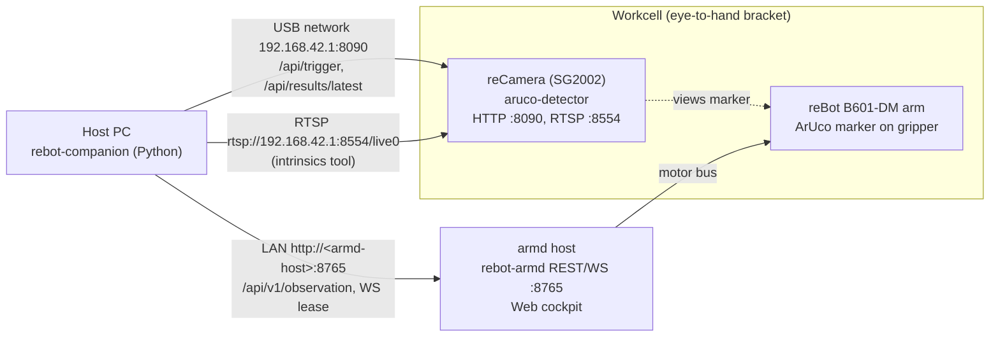

# rebot-companion · Robot Arm Vision Companion Toolkit

[中文文档](./README.zh-CN.md)

> **reCamera provides high-performance atomic sensing; remote Agents provide flexible orchestration; hardened pipelines provide deterministic execution.**

An open-source embodied robotics companion toolkit bridging **Seeed reCamera (SG2002 RISC-V edge vision)** and **rebot-armd (ultra-lightweight Rust arm daemon)**.

---

## 💡 Architecture & Boundary Definition

Given the edge compute constraints (SG2002 single-core 1.0 GHz RISC-V with 256MB RAM) and real-world industrial requirements, this toolkit enforces a clear **three-tier boundary**:

```text
┌────────────────────────────────────────────────────────┐
│  Stage 1: Remote Cloud / Host Agent Flexible Planning  │
│  Stage 2: Hardened Local Deterministic Pipeline Loop   │
└───────────────────────────┬────────────────────────────┘
                            │ REST / WebSocket
                            ▼
┌───────────────────────────────────┬────────────────────┐
│ Arm Control Daemon: rebot-armd    │ Vision Sensor: reCamera
│ - Pure Rust motor servo (50~100Hz)│ - Native C++ (Zero Python on camera)
│ - Slew Rate limiter & G(q) gravity│ - H.264 video stream (Port 8001)
│ - Watchdog & E-Stop state machine │ - On-demand single trigger /api/trigger
│ - LeRobot Parquet recorder        │ - Dynamic standby throttling (idle_fps=1)
└───────────────────────────────────┴────────────────────┘
```

### 1. reCamera Responsibility: Pure Atomic Capabilities
- **Zero Python on Camera**: To avoid CPU bottlenecks, context-switching overhead, and thermal throttling.
- **Pure Standard Endpoints**:
  - `POST /api/trigger`: Single-shot trigger estimating 6-DoF pose (`x, y, z, roll, pitch, yaw`), immediately returning to standby.
  - Frames for multimodal VLM / LLM reasoning: RTSP `rtsp://<host>:8554/live0` (1280x720). The device has no HTTP snapshot endpoint (`:80/snapshot.jpg` redirects to the supervisor UI); `ReCameraClient.get_snapshot()` works only when `snapshot_url=` is passed explicitly.
  - `WS :8001/`: Low-latency H.264 preview stream.

### 2. Two-Stage Evolution Workflow
- **Stage 1 (Exploration & Dynamic Orchestration)**:
  - Complex reasoning, multi-view inspection, and flexible task decomposition are driven by remote Agents / host Python scripts calling atomic APIs.
- **Stage 2 (Hardened Local Execution)**:
  - Once calibration matrices, trajectory points, and pick policies converge, the logic is serialized into a **deterministic local pipeline** running autonomously on the factory floor without external LLM dependencies.

---

## 📦 Project Layout

```text
rebot-companion/
├── pyproject.toml              # uv project; extras: [calib] = OpenCV for the intrinsics tool, [agent] = MCP server deps
├── rebot_companion/            # SDK
│   ├── camera_client.py        # reCamera atomic API client (trigger / latest result)
│   ├── arm_client.py           # rebot-armd client (REST reads + WebSocket lease session)
│   ├── snapshot.py             # JPEG snapshots from the camera H.264 stream + detection overlay
│   ├── mcp_server.py           # stdio MCP server (rebot-mcp) for agent control
│   ├── kinematics.py           # B601-DM forward / inverse kinematics (port of the Web cockpit)
│   ├── ik.py                   # IK adapter: base-frame pose -> armd 7-joint vector (incl. gripper)
│   ├── transforms.py           # SE(3) transforms, Euler ZYX convention
│   ├── calibration.py          # hand-eye calibration: point registration + AX=XB
│   └── pipeline.py             # Stage 2 deterministic pipeline
├── examples/
│   ├── 01_atomic_api_demo.py   # reCamera + armd atomic APIs
│   ├── 02_hand_eye_calib.py    # interactive hand-eye calibration wizard
│   ├── 03_agent_orchestrator.py# Stage 1 agent tool calling
│   └── 04_hardened_pick_place.py# Stage 2 hardened pick & place
├── tools/
│   ├── calibrate_intrinsics.py # camera intrinsics + distortion (OpenCV)
│   └── gen_web_fixtures.mjs    # regenerates JS reference values for the tests
└── tests/
```

---

## 🚀 Quickstart

### 1. Install (uv)
```bash
cd rebot-companion
uv sync
uv run pytest
```

Optional OpenCV extra for the intrinsics tool: `uv sync --extra calib`; MCP server extra: `uv sync --extra agent` (`uv sync --all-extras` for development).

### 2. Check the reCamera atomic API
```bash
uv run python examples/01_atomic_api_demo.py --url http://192.168.42.1:8090
```

`ReCameraClient.trigger()` posts a JSON body (aruco-detector >= 0.1.3 answers `415` to a POST without `Content-Type: application/json`; a 415 raises `CameraError`). It raises `CameraTriggerTimeout` on an HTTP timeout or a `success: false` reply; an empty list means the frame had no marker. Markers without a `pose` are skipped.

### 3. Run hand-eye calibration
```bash
uv run python examples/02_hand_eye_calib.py --arm-url http://<armd-host>:8765
```
See "Hand-eye calibration" below.

### 4. Run the Stage 2 hardened pick & place
```bash
uv run python examples/04_hardened_pick_place.py --dry-run   # detect + workspace check, arm does not move
uv run python examples/04_hardened_pick_place.py             # full cycle through B601IkAdapter
```

The example loads the calibration with `HandEyeCalibration.load_result()`, so eye_to_hand and eye_in_hand files are both handled. A cycle without an IK solver ends with `success=False`, `stage="dry_run"`; `stage="completed"` means the arm ran the whole cycle.

Cycle steps: open the gripper in place, approach (+80 mm) and grasp with the gripper open, close the gripper, lift, place, open the gripper, then `finish_action` (default `unload`). The gripper is joint index 6 of armd's 7-joint vector: `ik.GRIPPER_OPEN = -5.7` (open) .. `ik.GRIPPER_CLOSED = 0.0` (closed); armd soft limit -5.75 .. 0.10. `ik.B601IkAdapter` fills J1–J4 from the analytic IK (tool pointing down by default), J5 = 0, J6 = armd home (pi/2) or the current value (`j6=None`), J7 = gripper. armd rejects targets with any other length.

---

## 🔌 Topology

Eye-to-hand: the reCamera is fixed on a bracket next to the arm and looks at the workspace; the ArUco marker is on the gripper.



```text
 Host PC (rebot-companion)
   ├── USB network ──> reCamera 192.168.42.1   :8090 HTTP API, :8554 RTSP
   └── LAN ──────────> armd host <ip>          :8765 REST + WebSocket ──> arm motors
 reCamera on a fixed bracket, looking at the workspace; ArUco marker on the gripper.
```

Defaults in the examples: camera `http://192.168.42.1:8090`, arm `http://127.0.0.1:8765` (pass `--arm-url` when armd runs on another host).

---

## 🦾 Arm control

rebot-armd accepts actuator commands only on the WebSocket connection that holds the control lease; REST `motion/*`, torque and `clear_fault` return `LEASE_REQUIRED`.

- Read state without a lease: `ArmdClient.get_observation()` / `ArmdClient.get_schema()`.
- Move inside `with arm.session() as s:` (acquires the lease, heartbeats every 150 ms; armd lease timeout 2500 ms):
  `s.torque(True)`, `s.home()`, `s.move_to(q, duration=2.0)` (blocks until arrival), `s.servo_stream(frames, rate_hz=50)`, `s.unload()`.
- `ArmdClient.e_stop()` works without a lease.
- If the arm is still torqued when the session ends, armd latches `Fault(WatchdogTimeout)` about 2.5 s later, with the arm holding position. Finish with `s.unload()`, or later call `s.clear_fault()` then `s.torque(True)`.
- Safe exit: `arm.session(safe_exit="error")` (default) unloads a torqued arm when the `with` block raises (including Ctrl-C): clear a Fault, re-arm, `unload(wait=True)` bounded by `safe_exit_timeout` (30 s), then release the lease. `safe_exit="always"` also does this on a normal exit; `"off"` only releases. The result is in `s.safe_exit_outcome` (`unloaded`, `not_needed`, `unsupported`, `estop`, `no_lease`, `failed`). A latched EStop is not cleared. When armd has no resting-pose profile, `unload` answers `UNSUPPORTED`; the outcome is `unsupported` and the arm stays torqued.
- `s.torque(False)` is refused by armd (`ARM_NOT_AT_RESTING_POSE`) unless the arm is settled at the resting pose; use `s.unload()`.
- `s.unload()` raises `UnloadFailed` as soon as armd reports `Armed` with torque on after the unload motion (failed torque cut). After `s.unload(wait=False)`, closing the session waits for the unload, because a lease release cancels it in armd.
- Servo: `servo_stream()` needs `rate_hz >= 10` (armd drops the stream 200 ms after the last frame). armd drops frames that jump more than 0.35 rad from its commanded position without a reply (gripper exempt); `servo()` raises `ServoJumpError` for such a step instead of sending it.
- After a `force=True` preemption, motion is refused with `HANDOVER_SETTLING` for up to 1.5 s.
- High-level actions (armd with `/api/v1/action/*`): `s.move_pose(xyz, rpy=None | quat=None)` (straight-line Cartesian move of `end_link`; `move_to` stays the joint-space jog), `s.move_relative(frame, d, dyaw=, dpitch=, droll=)`, `s.gripper("open" | "close" | "move", fraction=)`, `s.home_action()`, `s.park_action()`, or `s.action(path, body)`. Each blocks until `observation.action` with the ack's `action_id` is terminal and returns an `ActionResult`; `failed` / `cancelled` raise `ActionFailed(code)`. The default timeout is `2 * expected_duration_s + 5` s, capped at 60 s; on timeout `stop` is sent and `MotionTimeout` raised. `ArmStatus.commanded_positions` and `ArmStatus.action` are empty / None on an armd without these fields.

```python
from rebot_companion import ArmdClient

arm = ArmdClient("http://127.0.0.1:8765")
with arm.session() as s:
    s.torque(True)
    target = list(s.home().positions)  # keep home J6 (pi/2) and the gripper
    target[0] += 0.2  # J1 +0.2 rad from home
    s.move_to(target, duration=2.0)
    s.unload()  # park + torque off before the lease is released
```

## 🤖 MCP server (agent control)

`rebot_companion/mcp_server.py` is a stdio MCP server that exposes the arm, camera snapshots and detections as tools. It needs the `agent` extra (`mcp` 2.x, `av`, `pillow`; tested with mcp 2.3.0, av 19.0.2, pillow 13.0.0).

```bash
uv run --directory /path/to/rebot-companion --extra agent rebot-mcp \
  --armd http://192.168.42.1:8765 --camera-ws ws://192.168.42.1:8001/ \
  [--client-id rebot-mcp] [--no-auto-lease] [--decoder auto|pyav|ffmpeg] \
  [--allow-clear-fault] [--allow-preempt]

# Claude Code
claude mcp add rebot -- uv run --directory /path/to/rebot-companion --extra agent rebot-mcp --armd http://192.168.42.1:8765
```

Logs go to stderr; stdout is the MCP channel.

| Tool | Input | Result |
|---|---|---|
| `get_state` | — | safety state, fault, torque, lease, joints (positions / commanded / velocities / torques / temperatures), `tcp` (host FK: `xyz_m`, `rpy_deg`, `quat` [w,x,y,z]), gripper, latest `action`, `epoch_id`. No lease needed |
| `snapshot` | `max_width` (800), `quality` (80) | JPEG image + JSON `{width, height, device_ts_ms, age_ms}` |
| `snapshot_annotated` | `min_score` (0.3), `max_width`, `quality` | JPEG with the latest detector boxes + JSON `{detections, det_frame_id, det_age_vs_frame_ms, note?}` |
| `detect` | `wait_ms` (2500, 0..5000), `min_score` (0.3) | `{frame_id, ts_ms, count, detections[{label, score, box_norm, center_norm, track_id}]}`; `POST /api/v1/detection/trigger`, on 404 enable → `latest` → disable (disables only if it enabled inference) |
| `move_to` | `x, y, z` (m), `roll_deg/pitch_deg/yaw_deg` or `quat`, `speed_mps` (≤ 0.15), `timeout_s` | `{action_id, state, settled, tcp_after, duration_s}`; straight line of `end_link`, orientation omitted = keep |
| `move_relative` | `frame` (`base`/`tool`/`camera`), `dx/dy/dz` (≤ 0.30 m), `dyaw_deg/dpitch_deg/droll_deg` (≤ 90), `level`, `speed_mps` | same as `move_to` |
| `gripper` | `command` (`open`/`close`/`move`), `fraction` (0 closed .. 1 open), `grasp` | `{holding, gap_rad, torque_nm, fraction, state}` |
| `home` / `park` | — | action result; `park` ends Idle with torque off |
| `stop` | — | `{state}`; runs while another tool is moving |
| `e_stop` | — | `{safety_state, epoch_id}`; no lease needed |
| `enable` | — | torque on |
| `clear_fault` | — | clear EStop or Fault; only with `--allow-clear-fault` |
| `take_control` | `force` (false, only with `--allow-preempt`) | acquire a free lease; with `--allow-preempt`, `force=true` takes control from the web cockpit |
| `release_control` | — | release the lease (the cockpit acquires it automatically) |

Lease rules:

- At startup the server tries a non-force lease. If the web cockpit or another client holds it, the server keeps running without it and actuator tools return `LEASE_BUSY`; each actuator call retries a non-force acquire. The server never sends `force=true` by itself.
- While the server holds the lease, its 150 ms heartbeat keeps it; the cockpit's 500 ms non-force retry does not take it over.
- If the cockpit preempts (its confirm button), tools return `LEASE_LOST`. The server does not re-acquire; control comes back only through `take_control`.
- By default the agent cannot take control from the cockpit or clear faults: `take_control` has no `force` parameter and `clear_fault` is not listed. After an E-stop or fault, error hints tell the agent to ask a person to clear it in the web cockpit. `--allow-preempt` adds `take_control(force=true)` (for use only after the user explicitly confirms; inside armd's cooldown it returns `PREEMPT_COOLDOWN` with `remaining_ms`). `--allow-clear-fault` adds the `clear_fault` tool.
- After `release_control`, or with `--no-auto-lease`, tools return `NO_LEASE` until `take_control`.
- On exit the session releases the lease; on an exception (including Ctrl-C) `safe_exit="error"` parks the arm first. If the process is killed, armd's watchdog latches a Fault with the arm holding position.

Errors come back as `isError` results whose text is JSON `{code, message, hint, safety_state}`; codes include `LEASE_BUSY`, `LEASE_LOST`, `NO_LEASE`, `ESTOP_ACTIVE`, `FAULT_ACTIVE`, `NOT_ARMED`, `WORKSPACE_VIOLATION`, `IK_UNREACHABLE`, `IK_BRANCH_FLIP`, `MOTION_BUSY`, `MOTION_TIMEOUT` (stop was sent), `TRACKING_STALL`, `STOPPED`, `SUPERSEDED`, `BUSY` (a second motion tool call while one runs), `CAMERA_UNAVAILABLE`, `SNAPSHOT_TIMEOUT`, `DETECTOR_UNAVAILABLE`, `UNSUPPORTED`. If the MCP client cancels a motion call, the server sends `stop`.

The move, gripper and action-status tools need an armd with the action API (`/api/v1/action/*`, `action` in the observation). `home` / `park` also work with an older armd.

Snapshots wait for the next IDR frame on the camera stream (default timeout 6 s), decoded with PyAV or, without it, the `ffmpeg` binary (`rebot_companion.snapshot`). Box positions are normalised to the image; they are only correct when the detector input has the same aspect ratio as the stream (not verified on the device).

---

## 🎯 Hand-eye calibration

### Forward kinematics (B601-DM)

`rebot_companion.kinematics` has two models, both in the URDF base frame (x forward, y left, z up, metres / radians):

- Full FK, `tcp_pose(q)` / `tcp_pose_from_joints(positions)` / `calibration.gripper_pose(positions)`: the URDF chain `base_link` → `joint1`..`joint6` → `end_joint` → `end_link` of `reBot-DevArm_gripper.urdf` (rebot-armd `assets/`, copy in `tests/fixtures/`). Returns the SE(3) TCP pose (position + rotation), x axis = tool axis. Hand-eye calibration uses this FK, so J5 and J6 may take any value in the samples. Tests compare it with an independent URDF parser: < 0.1 mm, < 0.01 deg.
- URDF joint5 = wrist swing (axis vertical at the park pose J1..J5 = 0, J6 = pi/2; +0.2 rad moves the TCP ~36 mm in -y), joint6 = tool roll (about the tool axis; the TCP position does not change). The Web cockpit UI labels these two the other way round.
- Motor → URDF mapping: armd index 0..3 → URDF joint1..joint4 with `model = (motor - offset) / sign` (Web `toModel` / `CFG.cart.sign` / `CFG.cart.off`, defaults sign `1,1,1,1`, offset `0`; same as the Web `?iksign=` / `?ikoff=` overrides; the wizard takes `--iksign` / `--ikoff`). Index 4 → joint5 and index 5 → joint6, 1:1. Index 6 (gripper) is not part of the FK.
- Planar FK/IK, `fk(q)` / `solve_ik(target, prev)`: line-by-line port of the rebot-armd Web cockpit (`src/api/index.html`, `IK.fk` / `IK.solve`), J1 yaw + J2/J3/J4 pitch chain, J5 = 0. Tests compare it against values computed by running the JS code with node (`tools/gen_web_fixtures.mjs`). With J5 = 0 its TCP position matches the full FK to < 0.2 mm (rounded Web constants, joint1 x offset of -0.084 mm ignored).
- `solve_ik(target, prev)` is the analytic position + pitch IK from the Web.

### Methods and assumptions

| `method` | Setup | Assumption | Uses | Result |
|---|---|---|---|---|
| `point` (default) | eye_to_hand | marker centre coincides with the TCP | positions only | `T_cam_to_base` (Horn closed form, same as the Web `solveRigid`) |
| `axxb` | eye_to_hand | marker rigid on the gripper, offset unknown | full poses | `T_cam_to_base` + `T_marker_to_gripper` |
| `axxb` | eye_in_hand | camera on the gripper, marker fixed in the scene | full poses | `T_cam_to_gripper` + `T_marker_to_base` |

- `axxb` = Park & Martin: rotation by least squares on rotation logarithms, translation by stacked linear least squares, over all sample pairs. Its result matches `cv2.calibrateHandEye(..., CALIB_HAND_EYE_PARK)` in the tests.
- `axxb` needs relative rotations about at least two non-parallel axes. With this arm, change both J1 yaw and wrist pitch (>= 15 deg) between samples; J5 swing and J6 roll add further rotation axes. Rotation about one axis only, or < 5 deg, raises `CalibrationError`.
- Residuals: `point` reports the 3D point error per sample; `axxb` reports per-sample marker position (m) and rotation (deg) prediction errors in the camera frame. RMSE and max error are printed and saved.
- Marker orientation from the device has 0.01 deg resolution (`r_deg`, 2 decimals). `point` does not use it.
- Accuracy depends on the camera intrinsics and `MARKER_SIZE` on the device. Calibrate intrinsics first (next section).

### Wizard

```bash
# eye-to-hand, marker centre on the TCP (default)
uv run python examples/02_hand_eye_calib.py --arm-url http://<armd-host>:8765 --marker-id 0
# marker anywhere on the gripper
uv run python examples/02_hand_eye_calib.py --method axxb --arm-url http://<armd-host>:8765
# re-solve samples exported from the Web cockpit
uv run python examples/02_hand_eye_calib.py --from-web-export rebot_hand_eye_2026-11-01T10-00-00.json
```

Pose the arm by hand (torque off) or with teleop, hold it still and press Enter. Each capture checks that the arm is not moving (|v| <= 0.02 rad/s, re-checked after detection), triggers one detection, picks the marker id, computes the TCP pose with FK, rejects samples closer than 10 mm to an existing one and appends to `calib_samples.json` (`--resume` continues a session). `s` solves and prints the residual table, `d` solves and writes `calibration.json`.

### Calibration file format

`save_to_file()` writes a superset of the Web cockpit export, so files from either side load with `HandEyeCalibration.load_result()` (returns `HandEyeResult(setup, transform)`) and `HandEyeCalibration.load_samples()` (returns samples to re-solve).

- `HandEyeResult.cam_to_base(joints)`: eye_to_hand returns `T_cam_to_base`; eye_in_hand returns `T_base_gripper(joints) @ T_cam_to_gripper`, with `joints` the armd positions when the image was taken. The pipeline reads them right before the trigger and fails the cycle if the arm moved during detection.
- `HandEyeCalibration.load_from_file()` returns `T_cam_to_base` for eye_to_hand files and raises `ValueError` for eye_in_hand files (their transform is `T_cam_to_gripper`).
- Legacy SDK files without `mode` / `setup` are rejected by `load_result()`.

```jsonc
{
  "version": 1, "kind": "hand_eye_calibration",
  "setup": "eye_to_hand",                    // or "eye_in_hand"
  "method": "point_registration_horn",       // or "axxb_park_martin"
  "assumption": "...", "units": {"length": "m", "angle": "deg"}, "created": "...", "marker_id": 0,
  "result": {
    "T_cam_to_base": [[...4x4...]],          // "T_cam_to_gripper" for eye_in_hand; p_target = T @ p_cam
    "translation_m": [x, y, z], "euler_rpy_deg": [roll, pitch, yaw],
    "euler_convention": "R = Rz(yaw) Ry(pitch) Rx(roll)",
    "rmse_m": 0.0012, "max_error_m": 0.0021, "residuals_m": [...], "samples": 9, "solved_at": "...",
    "rot_residuals_deg": [...], "rot_rmse_deg": 0.3,          // axxb only
    "T_marker_to_gripper": [[...]]                            // axxb only ("T_marker_to_base" for eye_in_hand)
  },
  "samples": [{"joints": [...], "p_base": [...], "p_cam": [...], "R_cam": [[...]], "rpy_cam_deg": [...],
               "marker_id": 0, "T_base_gripper": [[...]], "T_cam_marker": [[...]], "tcp_pitch": 0.5, "ts": "..."}],
  "transform": {"translation": [...], "euler_deg": [...], "matrix": [[...]]}   // legacy SDK block
}
```

Web samples without `R_cam` are position-only and can be solved with `method="point"` only. Their gripper rotation is recomputed from `joints` with the FK.

---

## 📷 Camera intrinsics

The detector's default intrinsics are placeholders (fx = fy = 600, cx = 320, cy = 180 at 640x360, no distortion). `tools/calibrate_intrinsics.py` estimates K and distortion with OpenCV:

```bash
uv sync --extra calib
# live: frames from rtsp://192.168.42.1:8554/live0, auto-capture when the board is still and the view is new
uv run python tools/calibrate_intrinsics.py --host 192.168.42.1 --board checkerboard --cols 9 --rows 6 --square 0.025
# ChArUco board
uv run python tools/calibrate_intrinsics.py --board charuco --cols 7 --rows 5 --square 0.04 --marker 0.03 --dict DICT_4X4_50
# offline: re-run on saved frames
uv run python tools/calibrate_intrinsics.py --images intrinsics_frames/20261109-101500
```

1. Print the board flat; measure the square size. `--cols/--rows` are inner corners (checkerboard) or squares (ChArUco).
2. Move the board across the whole image, near and far, tilted in all directions; the tool captures a frame after the board is still for 5 frames and differs from earlier views (default 20 views; frames are saved for offline re-runs).
3. The tool prints the reprojection RMS and writes `aruco-intrinsics.conf` with `CAMERA_WIDTH CAMERA_HEIGHT FX FY CX CY K1 K2 P1 P2 K3` (OpenCV order) at the inference resolution (`--infer-size`, default 640x360).
4. Merge the keys into `/etc/aruco-detector.conf` on the device and restart aruco-detector. The distortion keys need aruco-detector >= 0.1.1; the file is preserved across upgrades; JSON replies carry `"undistorted": true/false`.

Resolution assumption: calibration runs on the 1280x720 RTSP stream, the detector infers at 640x360 from the same sensor. The tool assumes the same field of view (no crop) and scales fx, fy, cx, cy by the width/height ratio (pixel-centre convention). This has not been verified on the device; check a measured marker distance against a tape measure.

---

## 🧪 Development

```bash
uv sync --all-extras
uv run ruff check && uv run ruff format --check
uv run pytest -q
node tools/gen_web_fixtures.mjs ../rebot-armd/src/api/index.html   # regenerate JS reference values
```

CI (`.github/workflows/ci.yml`) runs ruff and pytest on Python 3.10 and 3.12.
