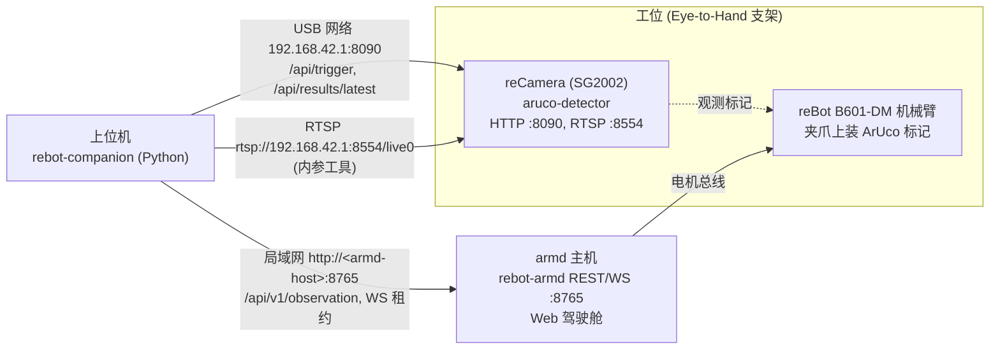

# rebot-companion · 机械臂视觉伴侣开源开发套件

[English](./README.md)

> **reCamera 负责极致的高性能原子感知，远程 Agent 负责灵活编排，固化程序负责工业级闭环。**

面向 **Seeed reCamera（SG2002 边缘视觉）** 与 **rebot-armd（极简 Rust 机械臂底座）** 的开源具身协同框架。

---

## 💡 核心架构与边界划分

针对嵌入式芯片（SG2002 单核 1.0 GHz RISC-V，256MB 内存）的算力瓶颈与工业现场的灵活性需求，本项目确立了明确的**三层职责边界**：

```text
┌────────────────────────────────────────────────────────┐
│  阶段一：云端 / 上位机 Agent 柔性编排 (多模态推理与决策)     │
│  阶段二：本地固化确定性程序 (Hardened Pipeline 极速闭环)  │
└───────────────────────────┬────────────────────────────┘
                            │ REST / WebSocket
                            ▼
┌───────────────────────────────────┬────────────────────┐
│ 运动控制底座: rebot-armd          │ 视觉感知底座: reCamera
│ - 纯 Rust 电机伺服控制 (50~100Hz)  │ - 纯 C++ 原生运行 (0 Python 依赖)
│ - Slew Rate 平滑插值与重力补偿 G(q)│ - H.264 视频流 (Port 8001)
│ - 机械臂安全状态机与 E-Stop 看门狗  │ - 按需单次触发 /api/trigger
│ - LeRobot Parquet 格式示教录制    │ - 动态待机控频 (idle_fps=1, 38℃常温)
└───────────────────────────────────┴────────────────────┘
```

### 1. reCamera 边缘职责：只做原子能力，杜绝本地复杂编排
- ❌ **严禁在 reCamera 上运行重型 Python 脚本或大模型**：避免单核 RISC-V 发生卡顿与高发热。
- ✅ **只提供通用、标准的原子接口**：
  - `POST /api/trigger`：单次触发抓拍，返回工件 6-DoF 姿态（X, Y, Z, Roll, Pitch, Yaw），算完立即待机。
  - 供远程 VLM / Agent 理解的图像帧：RTSP `rtsp://<host>:8554/live0`（1280x720）。设备没有 HTTP 快照接口（`:80/snapshot.jpg` 会重定向到 supervisor 页面）；`ReCameraClient.get_snapshot()` 仅在显式传入 `snapshot_url=` 时可用。
  - `WS :8001/`：提供低时延 H.264 视频推流。

### 2. 两阶段业务演进流
- **阶段一（探索与动态编排 - Exploration Mode）**：
  - 复杂的视觉语义理解、机械臂抓取时序规划、多模态 VLM 推理，由上位机或云端 Agent（如 Claude / GPT-4o / 本地 Python 脚本）通过调用 reCamera 和 `rebot-armd` 的标准化 API 来驱动。
  - 开发者可以随意调整提示词、抓取逻辑与异常重试，不影响边缘设备。
- **阶段二（固化与本地化运行 - Hardened Mode）**：
  - 当手眼标定矩阵、抓取动作序列、工位坐标完全验证收敛后，将逻辑固化为**确定性流水线程序（`Deterministic Pipeline`）**。
  - 直接在本地工控机或上位机运行，脱离对远程大模型的依赖，实现毫秒级高可靠闭环。

---

## 📦 项目结构

```text
rebot-companion/
├── pyproject.toml              # 基于 uv 的 Python 项目；可选 extra [calib] = 内参工具用的 OpenCV
├── rebot_companion/            # 核心 SDK
│   ├── __init__.py
│   ├── camera_client.py        # reCamera 原子能力客户端 (trigger / latest result)
│   ├── arm_client.py           # rebot-armd 客户端 (REST 读状态 + WebSocket 租约会话)
│   ├── kinematics.py           # B601-DM 正/逆运动学 (移植自 Web 驾驶舱)
│   ├── transforms.py           # 空间 SE(3) 刚体变换，欧拉角 ZYX 约定
│   ├── calibration.py          # 手眼标定：点配准 + AX=XB
│   └── pipeline.py             # 阶段二固化流水线执行引擎
├── examples/                   # 经典实操示例
│   ├── 01_atomic_api_demo.py   # 示例 1: 调用 reCamera / armd 原子接口
│   ├── 02_hand_eye_calib.py    # 示例 2: 交互式手眼标定向导
│   ├── 03_agent_orchestrator.py# 示例 3: 阶段一 远程 Agent 工具调用抓取编排
│   └── 04_hardened_pick_place.py# 示例 4: 阶段二 固化后的确定性现场抓取闭环
├── tools/
│   ├── calibrate_intrinsics.py # 相机内参 + 畸变标定 (OpenCV)
│   └── gen_web_fixtures.mjs    # 重新生成测试用的 JS 参考值
└── tests/                      # 单元测试与 Mock 验证
```

---

## 🚀 快速上手

### 1. 安装环境 (推荐使用 uv)
```bash
cd rebot-companion
uv sync
uv run pytest
```

内参工具需要可选的 OpenCV extra：`uv sync --extra calib`（开发时用 `uv sync --all-extras`）。

### 2. 验证 reCamera 原子接口
```bash
uv run python examples/01_atomic_api_demo.py --url http://192.168.42.1:8090
```

### 3. 运行手眼标定
```bash
uv run python examples/02_hand_eye_calib.py --arm-url http://<armd-host>:8765
```
详见下文「手眼标定」。

### 4. 运行阶段二固化闭环抓取
```bash
uv run python examples/04_hardened_pick_place.py
```

---

## 🔌 拓扑

Eye-to-Hand：reCamera 固定在机械臂旁的支架上俯视工作区，ArUco 标记装在夹爪上。



```text
 上位机 (rebot-companion)
   ├── USB 网络 ──> reCamera 192.168.42.1   :8090 HTTP API, :8554 RTSP
   └── 局域网 ────> armd 主机 <ip>          :8765 REST + WebSocket ──> 机械臂电机
 reCamera 固定在支架上俯视工作区；ArUco 标记装在夹爪上。
```

示例默认地址：相机 `http://192.168.42.1:8090`，机械臂 `http://127.0.0.1:8765`（armd 在其他主机上时传 `--arm-url`）。

---

## 🦾 机械臂控制

rebot-armd 只接受持有控制租约（lease）的 WebSocket 连接发来的执行器命令；REST 的 `motion/*`、torque、`clear_fault` 返回 `LEASE_REQUIRED`。

- 无需租约即可读状态：`ArmdClient.get_observation()` / `ArmdClient.get_schema()`。
- 运动放在 `with arm.session() as s:` 内（获取租约，每 150 ms 心跳；armd 租约超时 2500 ms）：
  `s.torque(True)`、`s.home()`、`s.move_to(q, duration=2.0)`（阻塞直到到位）、`s.servo_stream(frames, rate_hz=50)`、`s.unload()`。
- `ArmdClient.e_stop()` 不需要租约。
- 会话结束时机械臂仍处于上力矩状态，armd 约 2.5 s 后锁存 `Fault(WatchdogTimeout)`，机械臂保持当前位置。结束前调用 `s.unload()`，或之后调用 `s.clear_fault()` 再 `s.torque(True)`。
- 被 `force=True` 抢占后，最长 1.5 s 内运动命令会被 `HANDOVER_SETTLING` 拒绝。

```python
from rebot_companion import ArmdClient

arm = ArmdClient("http://127.0.0.1:8765")
q = arm.get_observation().positions
with arm.session() as s:
    s.torque(True)
    s.home()
    target = [0.0] * len(q)
    target[0] = 0.2  # J1 相对 home +0.2 rad
    s.move_to(target, duration=2.0)
    s.unload()  # 释放租约前回停靠位并卸力
```

---

## 🎯 手眼标定

### 正运动学（B601-DM）

`rebot_companion.kinematics` 逐行移植自 rebot-armd Web 驾驶舱的 FK/IK（`src/api/index.html` 中的 `IK.fk` / `IK.solve`，URDF `urdf_b601dm`）。测试用 node 运行 JS 代码得到的数值做对照（`tools/gen_web_fixtures.mjs`）。

- 使用的关节：J1 偏航，J2/J3/J4 俯仰链；J5 假定为 0；忽略夹爪。基座坐标系：x 向前、y 向左、z 向上，单位米 / 弧度。
- 电机原始角度到模型角：`model = (motor - offset) / sign`（Web `toModel`，默认 sign `1,1,1,1`、offset `0`；与 Web 的 `?iksign=` / `?ikoff=` 相同；向导参数为 `--iksign` / `--ikoff`）。
- `tcp_pose(q)` 返回完整 SE(3) TCP 位姿 `R = Rz(q1) Ry(-q2 + q3 + q4)`，x 轴为工具轴。腕部关节为 0 时与 URDF 链数值对比：位置差 < 0.03 mm，旋转差 < 1e-4。
- `solve_ik(target, prev)` 为 Web 中的解析 IK（位置 + 俯仰）。

### 方法与假设

| `method` | 构型 | 假设 | 使用数据 | 结果 |
|---|---|---|---|---|
| `point`（默认） | eye_to_hand | 标记中心与 TCP 重合 | 仅位置 | `T_cam_to_base`（Horn 闭式解，与 Web `solveRigid` 相同） |
| `axxb` | eye_to_hand | 标记刚性固定在夹爪上，偏移未知 | 完整位姿 | `T_cam_to_base` + `T_marker_to_gripper` |
| `axxb` | eye_in_hand | 相机装在夹爪上，标记固定在场景中 | 完整位姿 | `T_cam_to_gripper` + `T_marker_to_base` |

- `axxb` 为 Park & Martin 方法：对所有样本对，旋转用旋转对数的最小二乘求解，平移用堆叠线性最小二乘求解。测试中其结果与 `cv2.calibrateHandEye(..., CALIB_HAND_EYE_PARK)` 一致。
- `axxb` 要求相对旋转至少绕两个不平行的轴。对这台机械臂，样本之间要同时改变 J1 偏航和腕部俯仰（各 >= 15 度）。只绕单轴旋转或旋转 < 5 度会抛出 `CalibrationError`。
- 残差：`point` 输出每个样本的 3D 点误差；`axxb` 输出每个样本在相机坐标系下的标记位置（m）和旋转（度）预测误差。RMSE 和最大误差会打印并写入文件。
- 设备返回的标记姿态分辨率为 0.01 度（`r_deg`，2 位小数）。`point` 不使用姿态。
- 精度取决于设备上的相机内参和 `MARKER_SIZE`。先标定内参（见下一节）。

### 标定向导

```bash
# eye-to-hand，标记中心在 TCP（默认）
uv run python examples/02_hand_eye_calib.py --arm-url http://<armd-host>:8765 --marker-id 0
# 标记装在夹爪任意位置
uv run python examples/02_hand_eye_calib.py --method axxb --arm-url http://<armd-host>:8765
# 重新求解 Web 驾驶舱导出的样本
uv run python examples/02_hand_eye_calib.py --from-web-export rebot_hand_eye_2026-11-01T10-00-00.json
```

手动摆放机械臂（卸力）或用遥操作摆好后保持静止，按回车采集。每次采集会检查机械臂未在运动（|v| <= 0.02 rad/s，检测后再检查一次），触发一次检测，按 id 选取标记，用 FK 计算 TCP 位姿，拒绝与已有样本距离小于 10 mm 的样本，并追加写入 `calib_samples.json`（`--resume` 可继续上次会话）。`s` 求解并打印残差表，`d` 求解并写入 `calibration.json`。

### 标定文件格式

`save_to_file()` 写出的是 Web 驾驶舱导出格式的超集，两边的文件都可以用 `HandEyeCalibration.load_from_file()`（返回变换）和 `HandEyeCalibration.load_samples()`（返回样本以便重新求解）读取。

```jsonc
{
  "version": 1, "kind": "hand_eye_calibration",
  "setup": "eye_to_hand",                    // 或 "eye_in_hand"
  "method": "point_registration_horn",       // 或 "axxb_park_martin"
  "assumption": "...", "units": {"length": "m", "angle": "deg"}, "created": "...", "marker_id": 0,
  "result": {
    "T_cam_to_base": [[...4x4...]],          // eye_in_hand 时为 "T_cam_to_gripper"；p_target = T @ p_cam
    "translation_m": [x, y, z], "euler_rpy_deg": [roll, pitch, yaw],
    "euler_convention": "R = Rz(yaw) Ry(pitch) Rx(roll)",
    "rmse_m": 0.0012, "max_error_m": 0.0021, "residuals_m": [...], "samples": 9, "solved_at": "...",
    "rot_residuals_deg": [...], "rot_rmse_deg": 0.3,          // 仅 axxb
    "T_marker_to_gripper": [[...]]                            // 仅 axxb（eye_in_hand 时为 "T_marker_to_base"）
  },
  "samples": [{"joints": [...], "p_base": [...], "p_cam": [...], "R_cam": [[...]], "rpy_cam_deg": [...],
               "marker_id": 0, "T_base_gripper": [[...]], "T_cam_marker": [[...]], "tcp_pitch": 0.5, "ts": "..."}],
  "transform": {"translation": [...], "euler_deg": [...], "matrix": [[...]]}   // 旧版 SDK 字段
}
```

没有 `R_cam` 的 Web 样本只有位置，只能用 `method="point"` 求解；其夹爪旋转由 `joints` 经 FK 重新计算。

---

## 📷 相机内参

检测器默认内参是占位值（640x360 下 fx = fy = 600、cx = 320、cy = 180，无畸变）。`tools/calibrate_intrinsics.py` 用 OpenCV 估计 K 和畸变系数：

```bash
uv sync --extra calib
# 实时：从 rtsp://192.168.42.1:8554/live0 取帧，标定板静止且视角新颖时自动采集
uv run python tools/calibrate_intrinsics.py --host 192.168.42.1 --board checkerboard --cols 9 --rows 6 --square 0.025
# ChArUco 标定板
uv run python tools/calibrate_intrinsics.py --board charuco --cols 7 --rows 5 --square 0.04 --marker 0.03 --dict DICT_4X4_50
# 离线：用保存的帧重新计算
uv run python tools/calibrate_intrinsics.py --images intrinsics_frames/20261109-101500
```

1. 把标定板平整打印并量出方格边长。`--cols/--rows` 对棋盘格是内角点数，对 ChArUco 是方格数。
2. 让标定板覆盖整个画面，远近都要有，各方向倾斜；标定板静止 5 帧且与已采视角不同时自动采集（默认 20 帧，帧会保存以便离线重算）。
3. 工具打印重投影 RMS，并写出 `aruco-intrinsics.conf`，包含推理分辨率（`--infer-size`，默认 640x360）下的 `CAMERA_WIDTH CAMERA_HEIGHT FX FY CX CY K1 K2 P1 P2 K3`（OpenCV 顺序）。
4. 把这些键合并进设备上的 `/etc/aruco-detector.conf` 并重启 aruco-detector。畸变键需要 aruco-detector >= 0.1.1；该文件升级时保留；JSON 返回中带 `"undistorted": true/false`。

分辨率假设：标定在 1280x720 的 RTSP 流上进行，检测器在同一传感器的 640x360 通道上推理。工具假设两者视场相同（无裁剪），按宽/高比例缩放 fx、fy、cx、cy（像素中心约定）。这一点尚未在设备上验证；可用卷尺实测的标记距离与检测结果对比确认。

---

## 🧪 开发

```bash
uv sync --all-extras
uv run ruff check && uv run ruff format --check
uv run pytest -q
node tools/gen_web_fixtures.mjs ../rebot-armd/src/api/index.html   # 重新生成 JS 参考值
```

CI（`.github/workflows/ci.yml`）在 Python 3.10 和 3.12 上运行 ruff 和 pytest。
