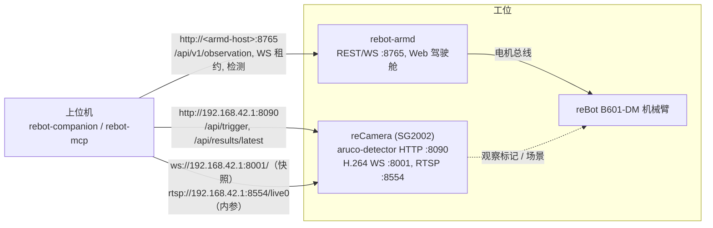

# rebot-companion

<div align="center">

### 🤖 面向 AI Agent 的机械臂视觉伴侣 SDK 与 MCP 工具服务器

**通过 MCP 让 AI Agent 控制 reBot 机械臂，并使用 reCamera 快照、检测和手眼标定**

[](https://www.python.org/)
[](LICENSE)
[](https://modelcontextprotocol.io)
[](https://github.com/Seeed-Solution/rebot-companion/actions)
[](https://github.com/Seeed-Solution/rebot-armd)
[](https://www.seeedstudio.com)

[English](./README.md) | 中文

<!-- TODO: Add demo GIF of AI Agent controlling the arm and camera via MCP here -->

</div>

---

用于 **reBot B601-DM** 机械臂的 Python SDK 和 stdio [MCP](https://modelcontextprotocol.io) 服务器。机械臂由运行在 **Seeed reCamera** 上的 [rebot-armd](https://github.com/Seeed-Solution/rebot-armd) 驱动；本项目同时提供相机快照、目标检测、ArUco 标记位姿和手眼标定。

- `rebot_companion`（SDK）：rebot-armd 客户端（REST 读取、WebSocket 控制租约、关节与笛卡尔动作）、reCamera ArUco 触发客户端、从相机 H.264 流截取 JPEG 快照、B601-DM 运动学、手眼标定、确定性抓放流水线。
- `rebot-mcp`：stdio [MCP](https://modelcontextprotocol.io) 服务器，把机械臂、快照和检测作为工具提供给各类 AI Agent。

## 核心特性

- **面向 AI Agent 的 stdio MCP 服务器（`rebot-mcp`）**：默认提供 14 个工具（状态、快照、检测、运动、夹爪、停止）。可用于支持 stdio 服务器的 MCP 客户端；端到端测试使用 Python `mcp` 客户端连接真机。清除故障和从驾驶舱接管默认关闭，需启动时显式开启（见 [MCP 服务器](#mcp-服务器agent-控制)）。
- **手眼标定**：眼在手外（闭式 Horn 点配准）与眼在手上（Park & Martin $AX=XB$），测试中与 OpenCV `CALIB_HAND_EYE_PARK` 交叉对比。精度仅在合成数据上验证，尚未在真机上实测。
- **两阶段**：阶段 1 由 Agent 编排工具；阶段 2 为不依赖大模型的本地确定性抓放流水线。
- **运动学**：完整 URDF 正运动学（测试中与独立 URDF 解析器相差 0.1 mm 以内）及 B601-DM 平面解析逆运动学。
- **reCamera 接入**：本项目不在相机上运行任何代码。支持按需触发检测（ArUco 标记 6-DoF 位姿、YOLO 2D 框），以及在主机端从相机 H.264 流解码 JPEG 快照。

> 本软件会驱动真实的机械臂。运行任何会动的代码之前，先阅读[安全](#安全)。

---

## 目录

- [核心特性](#核心特性)
- [架构](#架构)
- [硬件与软件要求](#硬件与软件要求)
- [安装](#安装)
- [快速上手](#快速上手)
- [项目结构](#项目结构)
- [拓扑](#拓扑)
- [机械臂控制](#机械臂控制)
- [MCP 服务器（agent 控制）](#mcp-服务器agent-控制)
- [手眼标定](#手眼标定)
- [相机内参](#相机内参)
- [示例](#示例)
- [安全](#安全)
- [开发](#开发)
- [致谢](#致谢)
- [许可证](#许可证)

---

## 架构

```text
┌────────────────────────────────────────────────────────────┐
│ 上位机：rebot-companion (Python)                            │
│  阶段 1：agent / 脚本编排 (rebot-mcp, 示例 03)              │
│  阶段 2：确定性流水线 (pipeline.py, 示例 04)                │
└───────────────────────────┬────────────────────────────────┘
                            │ HTTP / WebSocket
                            ▼
┌──────────────────────────────┬─────────────────────────────┐
│ rebot-armd（机械臂守护进程） │ reCamera 服务               │
│ REST + WS 租约   :8765       │ aruco-detector HTTP  :8090  │
│ 动作、限位、看门狗           │ H.264 WebSocket      :8001  │
│ 检测 API /api/v1/...         │ RTSP /live0          :8554  │
└──────────────────────────────┴─────────────────────────────┘
```

SDK 不在相机上运行。相机和 armd 提供单一用途的接口：

- `POST /api/trigger`（aruco-detector，:8090）：执行一次检测，返回标记位姿
  （`x, y, z, roll, pitch, yaw`）。
- `ws://<host>:8001/`：H.264 视频流；`rebot_companion.snapshot` 解码一个 IDR 帧为 JPEG。
- `rtsp://<host>:8554/live0`（1280x720）：内参标定工具使用。
- 设备上没有 HTTP 快照接口（`:80/snapshot.jpg` 会重定向到 supervisor 界面）。
  `ReCameraClient.get_snapshot()` 只有在显式传入 `snapshot_url=` 时才可用。
- armd 上的 `/api/v1/detection/*`：目标检测（`detect` / `snapshot_annotated` 工具）。

两个阶段：

- **阶段 1**：agent（通过 `rebot-mcp`）或上位机脚本调用上述接口，并决定下一步动作。
- **阶段 2**：标定、位姿和抓取参数确定后，`DeterministicPickPlacePipeline` 在不依赖 LLM 的情况下
  执行整个循环：触发、坐标变换、工作空间检查、在租约内运动。

---

## 硬件与软件要求

硬件：

- reBot B601-DM 机械臂（armd 使用 7 关节向量：J1..J6，夹爪为下标 6）。
- Seeed reCamera。默认配置假定 USB 网络地址为 `192.168.42.1`。
- 手眼标定和抓放流水线需要一个 ArUco 标记：贴在夹爪上（eye-to-hand）或固定在场景中（eye-in-hand）。

设备端软件：

- rebot-armd，可通过 HTTP/WebSocket 访问（默认端口 8765）。笛卡尔运动、夹爪和动作状态功能需要
  提供 `/api/v1/action/*` 且在 observation 中报告 `action` 的 armd 版本；`home` / `park` 在旧版本上也可用。
- reCamera 上的 aruco-detector，用于标记触发。触发请求需要 JSON body（aruco-detector >= 0.1.3
  否则返回 `415`；SDK 会发送 JSON body）。畸变参数需要 aruco-detector >= 0.1.1。

上位机：

- Python >= 3.10 和 [uv](https://docs.astral.sh/uv/)。
- 快照：PyAV（在 `agent` extra 中）或 `PATH` 上的 `ffmpeg`。
- 可选：Node.js，仅用于重新生成测试用的 JS 参考值。

---

## 安装

```bash
git clone https://github.com/Seeed-Solution/rebot-companion
cd rebot-companion
uv sync                      # 仅 SDK
uv sync --extra agent        # + MCP 服务器：mcp 2.x、av、pillow
uv sync --extra calib        # + OpenCV，用于 tools/calibrate_intrinsics.py
uv sync --all-extras         # 全部（开发用）
```

| Extra | 包 | 用途 |
|---|---|---|
| `agent` | `mcp>=2.3,<3`、`av>=12`、`pillow>=10` | `rebot-mcp`、PyAV 解码快照、带检测框的快照 |
| `calib` | `opencv-python-headless>=4.8,<5` | 相机内参工具 |

测试在 `uv.lock` 锁定的版本上运行（例如 mcp 2.3.0）。

---

## 快速上手

连接 armd、读取状态、截取快照、做一次小幅运动并停靠。用
`uv run --extra agent python quickstart.py` 运行。保持机械臂工作范围内无人无物。

```python
from rebot_companion import ArmdClient
from rebot_companion.snapshot import snapshot_once

arm = ArmdClient("http://192.168.42.1:8765")

# 1. 状态（REST，不需要租约）。MCP 工具 get_state 返回相同数据，另加上位机 FK 位姿。
obs = arm.get_observation()
print(obs.safety_state, obs.is_torqued, [round(q, 3) for q in obs.positions])

# 2. 快照：等待相机流上的下一个 IDR 帧（超时 6 s）。
snap = snapshot_once("ws://192.168.42.1:8001/", max_width=800)
open("snapshot.jpg", "wb").write(snap.jpeg)

# 3. 在控制租约内小幅运动并停靠（每 150 ms 心跳）。
with arm.session() as s:
    s.torque(True)
    s.home_action()
    s.move_relative("base", (0.0, 0.0, 0.02))  # 基座坐标系上移 2 cm；需要动作 API
    s.park_action()  # 回到休息位，然后关闭力矩
```

这段代码的机械臂部分在测试使用的 fake armd（`tests/fake_armd.py`）上验证过，未在硬件上验证。
没有动作 API 时，改用关节空间调用：`s.home()`、`s.move_to(q, duration=2.0)`、`s.unload()`
（见[机械臂控制](#机械臂控制)）。

---

## 项目结构

```text
rebot-companion/
├── pyproject.toml              # uv 项目；extras：[agent] = MCP 服务器，[calib] = OpenCV
├── rebot_companion/            # SDK
│   ├── arm_client.py           # rebot-armd 客户端（REST 读取 + WebSocket 租约会话 + 动作）
│   ├── camera_client.py        # reCamera aruco-detector 客户端（触发 / 最新结果）
│   ├── snapshot.py             # 从 H.264 流截取 JPEG 快照 + 检测框叠加
│   ├── mcp_server.py           # stdio MCP 服务器（rebot-mcp）
│   ├── kinematics.py           # B601-DM FK（完整 URDF 链）与平面 FK/IK（Web 驾驶舱移植）
│   ├── ik.py                   # IK 适配器：基座系位姿 -> armd 7 关节向量（含夹爪）
│   ├── transforms.py           # SE(3) 变换，欧拉角 ZYX 约定
│   ├── calibration.py          # 手眼标定：点配准 + AX=XB
│   └── pipeline.py             # 阶段 2 确定性抓放
├── examples/                   # 见「示例」
├── tools/
│   ├── calibrate_intrinsics.py # 相机内参 + 畸变（OpenCV）
│   └── gen_web_fixtures.mjs    # 重新生成测试用的 JS 参考值
└── tests/
```

---

## 拓扑



默认地址：

| 组件 | `rebot-mcp` 默认值 | 示例默认值 |
|---|---|---|
| rebot-armd | `http://192.168.42.1:8765`（armd 运行在 reCamera 上） | `http://127.0.0.1:8765`（用 `--arm-url` 指定） |
| 相机 H.264 流 | `ws://192.168.42.1:8001/` | — |
| aruco-detector | — | `http://192.168.42.1:8090` |

---

## 机械臂控制

rebot-armd 只接受持有控制租约的 WebSocket 连接发出的执行器命令；REST 的 `motion/*`、力矩和
`clear_fault` 返回 `LEASE_REQUIRED`。

- 无需租约读取状态：`ArmdClient.get_observation()` / `ArmdClient.get_schema()`。
- 在 `with arm.session() as s:` 内运动（获取租约，每 150 ms 心跳；armd 默认租约超时 2500 ms）：
  `s.torque(True)`、`s.home()`、`s.move_to(q, duration=2.0)`（阻塞直到到位）、
  `s.servo_stream(frames, rate_hz=50)`、`s.unload()`。
- `ArmdClient.e_stop()` 不需要租约。
- 租约过期时如果机械臂仍有力矩，由 armd 的看门狗处理。在本 README 核对的 rebot-armd 源码
  （commit `5aba3d5`）中：机械臂状态正常且有休息位时，停靠并关闭力矩；否则保持力矩原地锁定，
  并锁存 `Fault(WatchdogTimeout)`。旧版 armd 只做原地锁定并锁存故障。结束时调用 `s.unload()`；
  出现故障后先 `s.clear_fault()` 再 `s.torque(True)`。
- 安全退出：`arm.session(safe_exit="error")`（默认）在 `with` 块抛出异常（包括 Ctrl-C）时卸载
  有力矩的机械臂：清除 Fault、重新使能、`unload(wait=True)`（受 `safe_exit_timeout` 30 s 限制），
  然后释放租约。`safe_exit="always"` 在正常退出时也这样做；`"off"` 只释放租约。结果在
  `s.safe_exit_outcome`（`unloaded`、`not_needed`、`unsupported`、`estop`、`no_lease`、`failed`）。
  已锁存的 EStop 不会被清除。armd 没有休息位配置时，`unload` 返回 `UNSUPPORTED`，结果为
  `unsupported`，机械臂保持力矩。
- 机械臂未稳定在休息位时，armd 拒绝 `s.torque(False)`（`ARM_NOT_AT_RESTING_POSE`）；请使用 `s.unload()`。
- 卸载运动后 armd 报告 `Armed` 且力矩仍开启（切力矩失败）时，`s.unload()` 立即抛出 `UnloadFailed`。
  `s.unload(wait=False)` 之后关闭会话会先等待卸载完成，因为释放租约会让 armd 取消卸载。
- 伺服：`servo_stream()` 需要 `rate_hz >= 10`（armd 在最后一帧 200 ms 后丢弃流）。与指令位置相差超过
  0.35 rad 的帧会被 armd 静默丢弃（夹爪除外）；`servo()` 遇到这样的步长会抛出 `ServoJumpError`，不会发送。
- `force=True` 抢占之后，armd 在一段短暂的稳定期内以 `HANDOVER_SETTLING` 拒绝运动。
- 动作（armd 提供 `/api/v1/action/*` 时）：`s.move_pose(xyz, rpy=None | quat=None)`（`end_link`
  的笛卡尔直线运动；`move_to` 仍是关节空间运动）、`s.move_relative(frame, d, dyaw=, dpitch=, droll=)`、
  `s.gripper("open" | "close" | "move", fraction=)`、`s.home_action()`、`s.park_action()`，或
  `s.action(path, body)`。每个调用阻塞到 `observation.action` 中与 ack 的 `action_id` 对应的动作结束，
  返回 `ActionResult`；`failed` / `cancelled` 抛出 `ActionFailed(code)`。默认超时为
  `2 * expected_duration_s + 5` s，上限 60 s；超时后发送 `stop` 并抛出 `MotionTimeout`。
  armd 没有这些字段时，`ArmStatus.commanded_positions` 和 `ArmStatus.action` 为空 / None。

```python
from rebot_companion import ArmdClient

arm = ArmdClient("http://127.0.0.1:8765")
with arm.session() as s:
    s.torque(True)
    target = list(s.home().positions)  # 保留 home 的 J6 (pi/2) 和夹爪
    target[0] += 0.2  # J1 相对 home +0.2 rad
    s.move_to(target, duration=2.0)
    s.unload()  # 释放租约前停靠并关闭力矩
```

标记触发（`ReCameraClient`）：`trigger()` 发送 JSON body；返回 `415` 时抛出 `CameraError`。
HTTP 超时或回复 `success: false` 时抛出 `CameraTriggerTimeout`；空列表表示画面中没有标记。
没有 `pose` 的标记会被跳过。

---

## MCP 服务器（agent 控制）

`rebot_companion/mcp_server.py` 是 stdio MCP 服务器，需要 `agent` extra。

```bash
uv run --directory /path/to/rebot-companion --extra agent rebot-mcp \
  --armd http://192.168.42.1:8765 --camera-ws ws://192.168.42.1:8001/ \
  [--client-id rebot-mcp] [--no-auto-lease] [--decoder auto|pyav|ffmpeg] \
  [--allow-clear-fault] [--allow-preempt] [--log-level INFO]
```

### 接入 AI Agent 客户端

#### 通用 MCP 客户端配置（使用 `mcpServers` 字段的客户端，如 Claude Desktop 的 `claude_desktop_config.json`、Cursor、Windsurf）

在 Agent 的 MCP 配置文件中的 `mcpServers` 字段中添加：

```json
{
  "mcpServers": {
    "rebot": {
      "command": "uv",
      "args": [
        "run",
        "--directory", "/path/to/rebot-companion",
        "--extra", "agent",
        "rebot-mcp",
        "--armd", "http://192.168.42.1:8765"
      ]
    }
  }
}
```

相机流默认 `ws://192.168.42.1:8001/`；reCamera 地址不同时加 `"--camera-ws", "ws://<host>:8001/"`。配置格式不同的客户端（如 OpenCode）按其自身格式填写同样的命令和参数。

#### Claude Code 命令行添加

```bash
claude mcp add rebot -- uv run --directory /path/to/rebot-companion --extra agent rebot-mcp \
  --armd http://192.168.42.1:8765
```

日志输出到 stderr；stdout 是 MCP 通道。

| 参数 | 默认值 | 作用 |
|---|---|---|
| `--armd` | `http://192.168.42.1:8765` | rebot-armd 地址（机械臂和检测 API） |
| `--camera-ws` | `ws://192.168.42.1:8001/` | 用于快照的相机 H.264 流 |
| `--client-id` | `rebot-mcp` | 其他客户端看到的租约名称 |
| `--no-auto-lease` | 关 | 在 `take_control` 之前不获取租约 |
| `--decoder` | `auto` | `pyav`、`ffmpeg`，或 `auto`（已安装 PyAV 时用 PyAV） |
| `--allow-clear-fault` | **关** | 增加 `clear_fault` 工具 |
| `--allow-preempt` | **关** | 给 `take_control` 增加 `force` 参数（从 Web 驾驶舱抢占控制） |

工具：

| 工具 | 输入 | 结果 |
|---|---|---|
| `get_state` | — | 安全状态、故障、力矩、租约、关节（位置 / 指令 / 速度 / 力矩 / 温度）、`tcp`（上位机 FK：`xyz_m`、`rpy_deg`、`quat` [w,x,y,z]）、夹爪、最近的 `action`、`epoch_id`。不需要租约 |
| `snapshot` | `max_width`（800，64..1920）、`quality`（80，10..95） | JPEG 图像 + JSON `{width, height, device_ts_ms, age_ms}` |
| `snapshot_annotated` | `min_score`（0.3）、`max_width`、`quality` | 叠加最新检测框的 JPEG + JSON `{detections, det_frame_id, det_age_vs_frame_ms, note?}` |
| `detect` | `wait_ms`（2500，0..5000）、`min_score`（0.3） | `{frame_id, ts_ms, count, detections[{label, score, box_norm, center_norm, track_id}]}`；使用 `POST /api/v1/detection/trigger`；返回 404 时：开启推理 → `latest` → 关闭（仅当推理是本次开启的） |
| `move_to` | `x, y, z`（m）、`roll_deg/pitch_deg/yaw_deg` 或 `quat`、`speed_mps`（≤ 0.15，默认 0.05）、`timeout_s`（≤ 60） | `{action_id, state, settled, tcp_after, duration_s}`；`end_link` 直线运动；省略姿态 = 保持当前姿态 |
| `move_relative` | `frame`（`base`/`tool`/`camera`）、`dx/dy/dz`（每项 ≤ 0.30 m）、`dyaw_deg/dpitch_deg/droll_deg`（每项 ≤ 90）、`level`、`speed_mps` | 同 `move_to` |
| `gripper` | `command`（`open`/`close`/`move`）、`fraction`（0 闭合 .. 1 张开）、`grasp` | `{holding, gap_rad, torque_nm, fraction, state}` |
| `home` / `park` | — | 动作结果；`park` 结束于 Idle 且力矩关闭 |
| `stop` | — | `{state}`；在其他工具运动时也可执行 |
| `e_stop` | — | `{safety_state, epoch_id}`；不需要租约 |
| `enable` | — | 开启力矩 |
| `clear_fault` | — | 清除 EStop 或 Fault；仅在 `--allow-clear-fault` 时列出 |
| `take_control` | `force`（仅在 `--allow-preempt` 时） | 获取空闲租约；带 `--allow-preempt` 时，`force=true` 从 Web 驾驶舱抢占控制 |
| `release_control` | — | 释放租约（Web 驾驶舱会自动获取） |

表中的限制（速度 ≤ 0.15 m/s、步长 ≤ 0.30 m、旋转 ≤ 90 deg）由服务器的输入 schema 在调用到达 armd
之前检查；armd 另有自己的限制。

租约与安全规则：

- 启动时服务器尝试以非 force 方式获取租约。如果 Web 驾驶舱或其他客户端持有租约，服务器继续运行但
  不持有租约，执行器工具返回 `LEASE_BUSY`；每次执行器调用会重试一次非 force 获取。服务器不会自行发送
  `force=true`。
- 服务器持有租约期间，150 ms 心跳维持租约；驾驶舱的非 force 重试不会接管。
- 如果驾驶舱抢占（其确认按钮），工具返回 `LEASE_LOST`。服务器不会重新获取；只有通过 `take_control`
  才能恢复控制。
- **默认情况下 agent 不能从驾驶舱抢占控制，也不能清除故障**：`take_control` 没有 `force` 参数，
  `clear_fault` 不在工具列表中。急停或故障后，错误提示会让 agent 请人在 Web 驾驶舱中清除。
  - `--allow-preempt` 增加 `take_control(force=true)`。服务器指令要求 agent 只在用户明确确认后使用。
    在 armd 冷却期内返回 `PREEMPT_COOLDOWN` 和 `remaining_ms`。
  - `--allow-clear-fault` 增加 `clear_fault` 工具。
- `release_control` 之后，或使用 `--no-auto-lease` 时，工具返回 `NO_LEASE`，直到调用 `take_control`。
- 同一时间只运行一个运动工具；第二个调用返回 `BUSY`。`stop` 和 `e_stop` 随时可执行。
  MCP 客户端取消运动调用时，服务器发送 `stop`。
- 退出时会话释放租约；发生异常（包括 Ctrl-C）时 `safe_exit="error"` 先停靠机械臂。进程被强制结束时，
  由 armd 的租约看门狗处理（见[机械臂控制](#机械臂控制)）。

错误以 `isError` 结果返回，文本为 JSON `{code, message, hint, safety_state}`；错误码包括
`LEASE_BUSY`、`LEASE_LOST`、`NO_LEASE`、`ESTOP_ACTIVE`、`FAULT_ACTIVE`、`NOT_ARMED`、
`WORKSPACE_VIOLATION`、`IK_UNREACHABLE`、`IK_BRANCH_FLIP`、`MOTION_BUSY`、`MOTION_TIMEOUT`
（已发送 stop）、`TRACKING_STALL`、`STOPPED`、`SUPERSEDED`、`BUSY`、`CAMERA_UNAVAILABLE`、
`SNAPSHOT_TIMEOUT`、`DETECTOR_UNAVAILABLE`、`UNSUPPORTED`。

快照等待相机流上的下一个 IDR 帧（默认超时 6 s），用 PyAV 解码；没有 PyAV 时用 `ffmpeg`。
检测框坐标按图像归一化；只有检测器输入与视频流宽高比相同时才正确（未在设备上验证）。

---

## 手眼标定

### 正运动学（B601-DM）

`rebot_companion.kinematics` 有两个模型，都在 URDF 基座坐标系下（x 向前、y 向左、z 向上，单位米 / 弧度）：

- 完整 FK，`tcp_pose(q)` / `tcp_pose_from_joints(positions)` / `calibration.gripper_pose(positions)`：
  `reBot-DevArm_gripper.urdf`（rebot-armd `assets/`，副本在 `tests/fixtures/`）中的 URDF 链
  `base_link` → `joint1`..`joint6` → `end_joint` → `end_link`。返回 SE(3) TCP 位姿，x 轴 = 工具轴。
  手眼标定使用此 FK，因此样本中 J5、J6 可以取任意值。测试将其与独立的 URDF 解析器对比：< 0.1 mm、< 0.01 deg。
- URDF joint5 = 腕部摆动（在停靠位 J1..J5 = 0、J6 = pi/2 时轴竖直；+0.2 rad 使 TCP 沿 -y 移动约 36 mm），
  joint6 = 工具滚转（绕工具轴；TCP 位置不变）。Web 驾驶舱界面对这两个关节的标注与此相反。
- 电机 → URDF 映射：armd 下标 0..3 → URDF joint1..joint4，`model = (motor - offset) / sign`（Web
  `toModel` / `CFG.cart.sign` / `CFG.cart.off`，默认 sign `1,1,1,1`、offset `0`；与 Web 的
  `?iksign=` / `?ikoff=` 覆盖参数相同；向导接受 `--iksign` / `--ikoff`）。下标 4 → joint5、下标 5 →
  joint6，1:1。下标 6（夹爪）不参与 FK。
- 平面 FK/IK，`fk(q)` / `solve_ik(target, prev)`：逐行移植自 rebot-armd Web 驾驶舱（`src/api/index.html`，
  `IK.fk` / `IK.solve`），J1 偏航 + J2/J3/J4 俯仰链，J5 = 0。测试将其与用 node 运行 JS 代码得到的值对比
  （`tools/gen_web_fixtures.mjs`）。J5 = 0 时其 TCP 位置与完整 FK 相差 < 0.2 mm（Web 常数有舍入，
  忽略了 joint1 的 -0.084 mm x 偏移）。
- `solve_ik(target, prev)` 是 Web 中的解析位置 + 俯仰 IK。
- `ik.B601IkAdapter` 由解析 IK 求 J1–J4（默认工具朝下），J5 = 0，J6 = armd home（pi/2）或当前值
  （`j6=None`），J7 = 夹爪。armd 拒绝其他长度的目标。

### 方法与假设

| `method` | 安装方式 | 假设 | 使用 | 结果 |
|---|---|---|---|---|
| `point`（默认） | eye_to_hand | 标记中心与 TCP 重合 | 仅位置 | `T_cam_to_base`（Horn 闭式解，与 Web `solveRigid` 相同） |
| `axxb` | eye_to_hand | 标记刚性固定在夹爪上，偏移未知 | 完整位姿 | `T_cam_to_base` + `T_marker_to_gripper` |
| `axxb` | eye_in_hand | 相机在夹爪上，标记固定在场景中 | 完整位姿 | `T_cam_to_gripper` + `T_marker_to_base` |

- `axxb` = Park & Martin：旋转用旋转对数的最小二乘，平移用堆叠线性最小二乘，使用所有样本对。
  测试中其结果与 `cv2.calibrateHandEye(..., CALIB_HAND_EYE_PARK)` 一致。
- `axxb` 需要绕至少两个不平行轴的相对旋转。对这台机械臂，样本之间要同时改变 J1 偏航和腕部俯仰
  （>= 15 deg）；J5 摆动和 J6 滚转可以增加更多旋转轴。只绕一个轴旋转，或旋转 < 5 deg，会抛出 `CalibrationError`。
- 残差：`point` 报告每个样本的 3D 点误差；`axxb` 报告每个样本在相机坐标系下的标记位置（m）和旋转（deg）
  预测误差。RMSE 和最大误差会打印并保存。RMSE 超过 10 mm 时向导会给出警告。
- 设备返回的标记姿态分辨率为 0.01 deg（`r_deg`，2 位小数）。`point` 不使用姿态。
- 精度取决于相机内参和设备上的 `MARKER_SIZE`。先标定内参（[相机内参](#相机内参)）。

### 向导

```bash
# eye-to-hand，标记中心在 TCP 上（默认）
uv run python examples/02_hand_eye_calib.py --arm-url http://<armd-host>:8765 --marker-id 0
# 标记在夹爪上任意位置
uv run python examples/02_hand_eye_calib.py --method axxb --arm-url http://<armd-host>:8765
# 重新求解从 Web 驾驶舱导出的样本
uv run python examples/02_hand_eye_calib.py --from-web-export rebot_hand_eye_2026-11-01T10-00-00.json
```

用手摆放机械臂（力矩关闭）或用遥操作，保持静止后按 Enter。每次采集会检查机械臂没有运动
（|v| <= 0.02 rad/s，`--vel-threshold`，检测后再检查一次），触发一次检测，选取标记 id，用 FK 计算
TCP 位姿，拒绝与已有样本距离小于 10 mm 的样本，并追加到 `calib_samples.json`（`--resume` 继续上次会话）。
`s` 求解并打印残差表，`d` 求解并写入 `calibration.json`。

### 标定文件格式

`save_to_file()` 写入的格式是 Web 驾驶舱导出格式的超集，因此两边的文件都可以用
`HandEyeCalibration.load_result()`（返回 `HandEyeResult(setup, transform)`）和
`HandEyeCalibration.load_samples()`（返回可重新求解的样本）加载。

- `HandEyeResult.cam_to_base(joints)`：eye_to_hand 返回 `T_cam_to_base`；eye_in_hand 返回
  `T_base_gripper(joints) @ T_cam_to_gripper`，其中 `joints` 是拍摄图像时的 armd 关节位置。
  流水线在触发前读取关节位置，如果检测期间机械臂移动，本次循环失败。
- `HandEyeCalibration.load_from_file()` 对 eye_to_hand 文件返回 `T_cam_to_base`，对 eye_in_hand 文件
  抛出 `ValueError`（其变换是 `T_cam_to_gripper`）。
- 没有 `mode` / `setup` 的旧版 SDK 文件会被 `load_result()` 拒绝。

```jsonc
{
  "version": 1, "kind": "hand_eye_calibration",
  "setup": "eye_to_hand",                    // 或 "eye_in_hand"
  "method": "point_registration_horn",       // 或 "axxb_park_martin"
  "assumption": "...", "units": {"length": "m", "angle": "deg"}, "created": "...", "marker_id": 0,
  "result": {
    "T_cam_to_base": [[...4x4...]],          // eye_in_hand 为 "T_cam_to_gripper"；p_target = T @ p_cam
    "translation_m": [x, y, z], "euler_rpy_deg": [roll, pitch, yaw],
    "euler_convention": "R = Rz(yaw) Ry(pitch) Rx(roll)",
    "rmse_m": 0.0012, "max_error_m": 0.0021, "residuals_m": [...], "samples": 9, "solved_at": "...",
    "rot_residuals_deg": [...], "rot_rmse_deg": 0.3,          // 仅 axxb
    "T_marker_to_gripper": [[...]]                            // 仅 axxb（eye_in_hand 为 "T_marker_to_base"）
  },
  "samples": [{"joints": [...], "p_base": [...], "p_cam": [...], "R_cam": [[...]], "rpy_cam_deg": [...],
               "marker_id": 0, "T_base_gripper": [[...]], "T_cam_marker": [[...]], "tcp_pitch": 0.5, "ts": "..."}],
  "transform": {"translation": [...], "euler_deg": [...], "matrix": [[...]]}   // 旧版 SDK 字段
}
```

示例中的数值仅作说明。没有 `R_cam` 的 Web 样本只有位置，只能用 `method="point"` 求解；其夹爪旋转由
`joints` 经 FK 重新计算。

---

## 相机内参

检测器的默认内参是占位值（640x360 下 fx = fy = 600、cx = 320、cy = 180，无畸变）。
`tools/calibrate_intrinsics.py` 用 OpenCV 估计 K 和畸变参数：

```bash
uv sync --extra calib
# 实时：从 rtsp://192.168.42.1:8554/live0 取帧，标定板静止且视角新颖时自动采集
uv run python tools/calibrate_intrinsics.py --host 192.168.42.1 --board checkerboard --cols 9 --rows 6 --square 0.025
# ChArUco 标定板
uv run python tools/calibrate_intrinsics.py --board charuco --cols 7 --rows 5 --square 0.04 --marker 0.03 --dict DICT_4X4_50
# 离线：用保存的帧重新计算
uv run python tools/calibrate_intrinsics.py --images intrinsics_frames/20261109-101500
```

1. 平整打印标定板，测量方格尺寸。`--cols/--rows` 为内角点数（棋盘格）或方格数（ChArUco）。
2. 在整个画面内移动标定板，远近都要有，各方向倾斜；标定板静止 5 帧且与之前的视角不同时，工具采集一帧
   （默认 20 个视角，`--target`；帧会保存以便离线重算）。
3. 工具打印重投影 RMS，并按推理分辨率（`--infer-size`，默认 640x360）写出 `aruco-intrinsics.conf`，包含
   `CAMERA_WIDTH CAMERA_HEIGHT FX FY CX CY K1 K2 P1 P2 K3`（OpenCV 顺序）。
4. 将这些键合并到设备上的 `/etc/aruco-detector.conf` 并重启 aruco-detector。畸变参数需要
   aruco-detector >= 0.1.1；该文件在升级时保留；JSON 回复中带 `"undistorted": true/false`。

分辨率假设：标定在 1280x720 的 RTSP 流上进行，检测器在同一传感器的 640x360 画面上推理。工具假设两者
视场相同（无裁剪），按宽高比例缩放 fx、fy、cx、cy（像素中心约定）。这一点未在设备上验证；请用卷尺
核对一次实测的标记距离。

---

## 示例

| 脚本 | 内容 | 是否驱动机械臂 |
|---|---|---|
| `examples/01_atomic_api_demo.py` | reCamera 触发和 armd 状态；`--move` 执行开力矩、回 home、微动 J1、卸载 | 仅在 `--move` 时 |
| `examples/02_hand_eye_calib.py` | 交互式手眼标定向导（见上文） | 否（由人摆放机械臂） |
| `examples/03_agent_orchestrator.py` | 阶段 1 工具调用模式：JSON schema 工具定义和分发函数 | 仅 `plan_and_execute_pick`，且需要 `--calib` |
| `examples/04_hardened_pick_place.py` | 阶段 2 通过 `B601IkAdapter` 执行抓放循环 | 是，除非 `--dry-run` |

```bash
uv run python examples/01_atomic_api_demo.py --url http://192.168.42.1:8090 --arm-url http://<armd-host>:8765
uv run python examples/03_agent_orchestrator.py --calib calibration.json   # 没有标定文件时用 --dry-run
uv run python examples/04_hardened_pick_place.py --dry-run   # 检测 + 工作空间检查，机械臂不动
uv run python examples/04_hardened_pick_place.py --calib calibration.json --cycles 1
```

示例 03 和 04 的标定处理：用 `HandEyeCalibration.load_result()` 加载文件，因此 eye_to_hand 和
eye_in_hand 文件都可用。没有标定文件时，两个示例使用一个占位变换，它不是标定结果：示例 03 会标明
其位置不真实，并在未设置 `--dry-run` 时拒绝执行 `plan_and_execute_pick`；示例 04 在未设置 `--dry-run`
时报错退出。

流水线结果：没有 IK 求解器的循环（dry run）以 `success=False`、`stage="dry_run"` 结束；
`stage="completed"` 表示机械臂完成了整个循环。循环步骤：原地张开夹爪，接近（+80 mm）并在夹爪张开状态下
到达抓取位，闭合夹爪，抬起，放置，张开夹爪，然后执行 `finish_action`（默认 `unload`）。夹爪是 armd
7 关节向量的下标 6：`ik.GRIPPER_OPEN = -5.7`（张开）.. `ik.GRIPPER_CLOSED = 0.0`（闭合）；armd 的夹爪
关节限位为 -5.75 .. 0.10。在任何运动之前，流水线拒绝距基座超过 `PipelineConfig.max_allowed_distance`
（默认 0.80 m）或低于 z = -0.05 m 的目标。

---

## 安全

本 SDK 和 MCP 服务器会驱动真实的机械臂。软件限制能降低风险，但不能让人在机械臂旁边变得安全。

- 机械臂有力矩时，人、手和散落物品不要进入其可达范围。随时能使用 Web 驾驶舱或其他急停手段；
  `ArmdClient.e_stop()` 和 MCP 的 `e_stop` 工具不需要租约。
- 限制由 rebot-armd 执行。在其源码（commit `5aba3d5`）中：关节位置和速度限位；工作空间检查（地面、
  盒体和可达范围边界），超出的目标和笛卡尔路径以 `WORKSPACE_VIOLATION` 拒绝；笛卡尔速度上限（线速度
  ≤ 0.15 m/s，角速度 ≤ 1.0 rad/s）；有力矩时心跳停止，租约看门狗停靠机械臂（或原地锁定并锁存故障）。
  具体数值取决于 armd 版本和配置，请在你的 armd 上核对。
- 本 SDK 另有客户端检查：MCP 输入限制（见工具表）、伺服步长检查（0.35 rad）、流水线距离检查、
  以及会话在出错时的安全退出。
- 新代码先用低速、小步长和 dry run（示例 03 和 04 的 `--dry-run`）。
- 不要用占位或未验证的手眼标定执行运动。
- `--allow-preempt` 和 `--allow-clear-fault` 允许 agent 从驾驶舱前的人手中抢占控制并清除故障。默认关闭。

---

## 开发

```bash
uv sync --all-extras
uv run ruff check && uv run ruff format --check
uv run pytest -q
node tools/gen_web_fixtures.mjs ../rebot-armd/src/api/index.html   # 重新生成 JS 参考值
```

测试使用进程内的模拟对象（armd：`tests/fake_armd.py`）和录制的数据，不需要硬件。CI
（`.github/workflows/ci.yml`）在 Python 3.10、3.11、3.12 和 3.13 上安装全部 extras 运行 ruff 和 pytest。
另见 [CONTRIBUTING.md](./CONTRIBUTING.md) 和 [SECURITY.md](./SECURITY.md)（英文）。

---

## 致谢

- **[Model Context Protocol (MCP)](https://modelcontextprotocol.io)**：连接 AI Agent 与物理工具的开放协议标准；
- **[rebot-armd](https://github.com/Seeed-Solution/rebot-armd)**：带 LeRobot Parquet 录制的 Rust 机械臂守护进程；
- **[Seeed Studio](https://www.seeedstudio.com/)**：reCamera SG2002 边缘视觉传感器与 reBot B601-DM 机械臂平台；
- **[OpenCV](https://opencv.org/)**：相机标定与计算机视觉算法库。

---

## 许可证

MIT，见 [LICENSE](./LICENSE)。Copyright (c) 2026 Seeed Studio & Contributors。

`tests/fixtures/reBot-DevArm_gripper.urdf` 派生自 [reBot-DevArm](https://github.com/Seeed-Projects/reBot-DevArm)
的 URDF，该项目采用 CERN Open Hardware Licence Version 2 - Weakly Reciprocal（CERN-OHL-W-2.0）。
